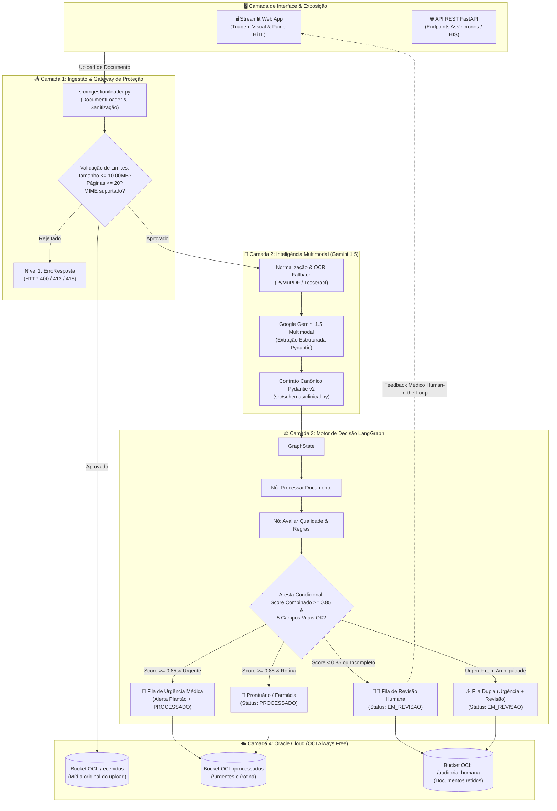
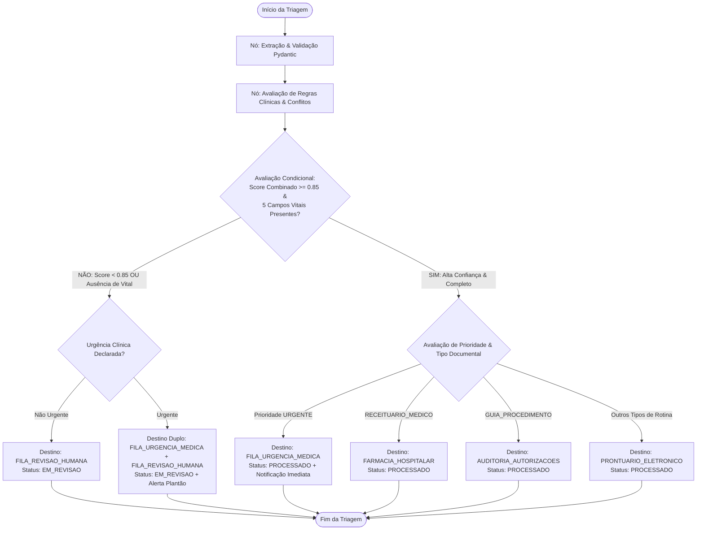

# 🏥 MediFlow: Arquitetura do Sistema e Especificação Técnica

> **Hackathon ONE G10 — Oracle Next Education & Alura**  
> **Projeto 2:** Agente Autônomo para Triagem, Extração e Roteamento de Documentos Clínicos  
> **Equipe 15:** MediFlow  
> **Manual Oficial de Referência:** `34aa946f-2883-4917-aec1-aae0df0f43d1.pdf`  
> **Implementação Central:** [`src/schemas/clinical.py`](src/schemas/clinical.py) | **Suíte de Testes:** 149 testes automatizados via Pytest  

---

## 📌 1. Visão Geral e Contexto da Solução

O **MediFlow** é um agente autônomo inteligente projetado para os setores de **HealthTech, Gestão Hospitalar e Operadoras de Saúde**. Ele automatiza a triagem, a extração estruturada de dados clínicos e o roteamento de documentos heterogêneos (receitas médicas, laudos laboratoriais e de imagem, guias de autorização TISS/TUSS, relatórios de alta e atestados médicos). A solução resolve o problema de atrasos no atendimento emergencial, elimina tarefas manuais repetitivas e reduz custos com glosas hospitalares com estrito rigor regulatório e de segurança.

### 🎯 Matriz de Aderência ao Manual Oficial da Oracle (Projeto 2):

| Requisito do Edital Oracle | Implementação Técnica no MediFlow | Módulo / Código Responsável |
| :--- | :--- | :--- |
| **Ingestão Multimodal (Upload e API REST)** | Suporte a upload de arquivos PDF (digital e escaneado), imagens (JPG, PNG, WEBP) e TXT; integração via API REST com envelopes JSON. Bloqueio estrito de DOCX e outros formatos não suportados (HTTP 415). Limites de segurança: **máximo de 10.00 MB** e **máximo de 20 páginas por documento** (Regra A6). | [`src/ingestion/loader.py`](src/ingestion/loader.py) |
| **Classificação de Tipo Documental** | Classificação automática nas 8 categorias controladas (`RECEITUARIO_MEDICO`, `LAUDO_EXAME_LABORATORIAL`, `LAUDO_EXAME_IMAGEM`, `GUIA_PROCEDIMENTO`, `RELATORIO_ALTA_INTERNACAO`, `ATESTADO_MEDICO`, `OUTRO`, `NAO_IDENTIFICADO`). | [`src/agents/`](src/agents/) |
| **Extração Estruturada com LLM Multimodal** | Extração de entidades clínicas via Google Gemini 1.5 com *Structured Outputs*: Paciente, Médico/CRM com UF paulista/nacional, Diagnóstico/CID-10, Medicamentos (nome, dose, frequência), Exames/Analitos laboratoriais (RF-12) e declaração de urgência. | [`src/agents/`](src/agents/) & [`src/schemas/clinical.py`](src/schemas/clinical.py) |
| **Grafo de Decisão Condicional (LangGraph)** | Grafo de estados (`StateGraph`) com nós de extração, validação de regras clínicas e arestas condicionais de roteamento para 5 departamentos. | [`src/workflow/`](src/workflow/) |
| **Tratamento de Urgências e Human-in-the-Loop** | Notificação imediata para a equipe de plantão em casos urgentes e retenção obrigatória em fila de auditoria humana (*Human-in-the-Loop*) em caso de ambiguidade, rasura, campo vital ausente ou score $< 0.85$. | [`src/workflow/edges.py`](src/workflow/edges.py) |
| **Persistência OCI Object Storage (Always Free)** | Organização e segregação de arquivos e metadados em buckets gratuitos da nuvem Oracle (`/recebidos`, `/processados/urgentes`, `/processados/rotina`, `/auditoria_humana`). | [`src/storage/`](src/storage/) |
| **Demonstração dos 3 Cenários Obrigatórios** | Cobertura comprovada por testes e dados sintéticos: (1) Fluxo Padrão de Rotina, (2) Urgência Médica (TEP Agudo), (3) Caso Ambíguo para Revisão Humana. | [`tests/fixtures/demo/`](tests/fixtures/demo/) |
| **Diferenciais Implementados** | Interface web em Streamlit para Human-in-the-Loop, OCR fallback, detecção de doses terapêuticas anômalas e governança com 79 fixtures oficiais. | [`src/app/`](src/app/), [`src/workflow/graph.py`](src/workflow/graph.py) & [`src/schemas/clinical.py`](src/schemas/clinical.py) |

---

## 🏗️ 2. Diagrama de Arquitetura em Camadas

O MediFlow é estruturado em 5 camadas funcionais desacopladas e auditáveis:



---

## 🧩 3. Detalhamento das 5 Camadas de Engenharia

### 3.1 Camada 1: Ingestão, Validação e Gateway (`src/ingestion/`)
- **Objetivo:** Blindar a esteira de processamento contra ataques, custos desnecessários com tokens de IA e falhas de leitura.
- **Regras Executadas:**
  - **Tamanho Máximo:** Rejeição imediata de arquivos $> 10.00\text{ MB}$ com HTTP 413 `ARQUIVO_MAIOR_QUE_LIMITE`.
  - **Limite de Páginas:** Rejeição de PDFs com mais de 20 páginas (HTTP 413).
  - **Formatos Aceitos para Upload (Allowlist A6):** `.pdf` (digital e digitalizado), `.txt` e imagens (`.jpg`, `.jpeg`, `.png`, `.webp`).
  - **Integração via API REST:** Envelopes estruturados em `JSON` contendo o payload e texto clínico.
  - **Formatos Bloqueados no Gateway (Negativos Técnicos):** Rejeição imediata com `HTTP 415 FORMATO_NAO_SUPORTADO` para arquivos `.docx`, `.zip`, executáveis ou qualquer extensão fora do allowlist (comprovado pelo teste e fixture `Validacao_ArquivoDocx.docx`).
  - **Tratamento Precoce de Falhas:** Detecção imediata de PDFs com senha (`PDF_PROTEGIDO`) e PDFs ilegíveis/corrompidos (`PDF_CORROMPIDO`), emitindo contratos de erro sem executar inferência.

### 3.2 Camada 2: Inteligência Multimodal e Schemas (`src/agents/` e `src/schemas/`)
- **Objetivo:** Compreender visualmente o documento e estruturar os dados clínicos.
- **Componentes:**
  - **Google Gemini 1.5:** Utiliza prompt de sistema especializado em taxonomia médica brasileira e *response_schema* formal.
  - **Contrato Canônico Pydantic v2 ([`src/schemas/clinical.py`](src/schemas/clinical.py)):** Modelo de dados unificado com validação estrita de tokens, enums resilientes via `_missing_` e suporte a submodelos dedicados (`Paciente`, `Medico`, `Crm`, `ItemExameLaboratorial`, `ConflitoQualidade`).

### 3.3 Camada 3: Motor de Decisão LangGraph (`src/workflow/`)
- **Objetivo:** Garantir a governança do fluxo de decisão de forma auditável e não probabilística.
- **Componentes:**
  - `GraphState`: Estado compartilhado contendo dados brutos, entidades extraídas, qualidade e decisões.
  - **Avaliação de Qualidade e Regras Clínicas** ([`src/workflow/graph.py`](src/workflow/graph.py) e [`src/schemas/clinical.py`](src/schemas/clinical.py)): Motor determinístico que avalia conflitos impeditivos, limites terapêuticos (ex: sobredosagem de fármacos) e inconsistências cadastrais.
  - `Arestas Condicionais`: Decisão matemática entre os 5 destinos do edital.

### 3.4 Camada 4: Armazenamento OCI Always Free (`src/storage/`)
- **Objetivo:** Persistência em nuvem segura em conformidade com as diretrizes do edital da Oracle.
- **Política Always Free:** Utiliza exclusivamente a camada gratuita da Oracle Cloud Infrastructure, segregando objetos em pastas lógicas no bucket `mediflow-documentos-clinicos`.

### 3.5 Camada 5: Apresentação e Integração (`src/app/` e `src/api/`)
- **Streamlit Web App:** Tela visual intuitiva para upload rápido, visualização de documentos originais lado a lado com os dados extraídos, e bancada de revisão clínica (*Human-in-the-Loop*).
- **FastAPI Server:** Interface RESTful assíncrona (`POST /api/v1/triagens` respondendo com `HTTP 202 Accepted` e `GET /api/v1/triagens/{id}` para polling do resultado).

---

## ⚖️ 4. O Grafo de Decisão Clínica (LangGraph)

O fluxo de decisão segue um grafo determinístico modelado com o **LangGraph**:



### Regras Clínicas de Roteamento (R1 a R8):
1. **Fórmula do Score Combinado (Regra R5):**  
   $$\text{score\_combinado} = \min(\text{score\_classificacao}, \text{score\_extracao})$$
2. **Limiar Clínico Estrito ($0.85$):**  
   - $\ge 0.85$ sem conflitos impeditivos $\rightarrow$ **Aprovado para roteamento automático (`PROCESSADO`)**.
   - $< 0.85$ $\rightarrow$ **Retido para revisão humana (`EM_REVISAO`)**.
3. **Os 5 Campos Vitais Obrigatórios (RF-21 / Regra R6):**  
   `paciente.nome`, `paciente.idade`, `medico.nome`, `medico.crm`, `diagnostico`. A ausência de qualquer um deles retém o documento em `EM_REVISAO`.
4. **Tratamento de Urgência Conforme o Edital (Regra R1):**  
   Urgência bem documentada e sem ambiguidades termina com status `PROCESSADO`, `requer_auditoria_humana = False` e destino único `FILA_URGENCIA_MEDICA`.
5. **Casos Mistos (Regra R4):**  
   Urgência acompanhada de rasura ou ambiguidade gera atribuição dupla (`FILA_URGENCIA_MEDICA` + `FILA_REVISAO_HUMANA`) em `EM_REVISAO` com `requer_auditoria_humana = True`.

---

## 📋 5. O Contrato Canônico de Dados (`TriagemMediFlow`)

Abaixo está o payload canônico oficial gerado pelo MediFlow, modelado a partir do exemplo oficial das páginas 4 e 5 do manual da Oracle:

```json
{
  "status": "processado",
  "documento_id": "DOC-CLIN-2026-8942",
  "classificacao": {
    "tipo_documento": "LAUDO_EXAME_IMAGEM",
    "especialidade": ["Radiologia", "Pneumologia"],
    "nivel_prioridade": "URGENTE",
    "score_classificacao": 0.99
  },
  "dados_extraidos": {
    "paciente": {
      "nome": "Carlos Eduardo Mendes",
      "idade": 52,
      "cpf": null
    },
    "medico": {
      "nome": "Dra. Renata Silveira",
      "crm": {
        "numero": "145892",
        "uf": "SP"
      }
    },
    "diagnostico": "Tromboembolismo Pulmonar Agudo (TEP)",
    "cid": "I26.9",
    "exames": ["Tomografia de Tórax com contraste"],
    "medicamentos": [],
    "urgencia": "SIM"
  },
  "qualidade": {
    "score_extracao": 0.98,
    "score_combinado": 0.98,
    "limiar_aplicado": 0.85,
    "campos_ausentes": [],
    "campos_incertos": [],
    "conflitos": []
  },
  "decisao_roteamento": {
    "destino_principal": "FILA_URGENCIA_MEDICA",
    "destinos": ["FILA_URGENCIA_MEDICA"],
    "requer_auditoria_humana": false,
    "justificativa_roteamento": "Achado crítico de alta gravidade (TEP agudo) detectado em paciente sintomático.",
    "notificacao": {
      "canal": "Alerta_Plantao_Medico",
      "mensagem": "ALERTA URGENTE: Laudo crítico de TEP Agudo para paciente Carlos Eduardo Mendes no Pronto-Socorro."
    }
  },
  "armazenamento_oci": {
    "bucket": "mediflow-documentos-clinicos",
    "caminho_objeto": "processados/urgentes/DOC-CLIN-2026-8942.json",
    "status_backup": "sucesso"
  },
  "erro": null
}
```

---

## ☁️ 6. Topologia de Armazenamento OCI (Always Free)

A segregação dos documentos no OCI Object Storage obedece à hierarquia abaixo:

```text
mediflow-documentos-clinicos/ (Bucket OCI Always Free)
│
├── recebidos/                                  <- Mídia original no momento do upload (PDF/JPG/TXT)
│   ├── DOC-CLIN-2026-8942.pdf
│   └── DOC-A757DAD2.jpg
│
├── processados/                                <- Documentos triados com sucesso
│   ├── urgentes/                               <- Encaminhados para plantão médico de urgência
│   │   └── DOC-CLIN-2026-8942.json
│   └── rotina/                                 <- Prontuário Eletrônico, Farmácia e Auditoria TISS
│       └── DOC-B1234567.json
│
└── auditoria_humana/                           <- Documentos retidos para revisão (Human-in-the-Loop)
    ├── baixa_confianca/                        <- Score combinado < 0.85 ou rasuras
    └── dados_incompletos/                      <- Ausência de CRM, médico ou hipótese diagnóstica
```

---

## 🧪 7. Engenharia de Qualidade e Suíte de Testes (149 Testes)

A conformidade do MediFlow com os requisitos funcionais e com o edital da Oracle é auditada por uma suíte de 149 testes automatizados no Pytest:

| Módulo de Teste | Quantidade | Escopo e Cobertura Técnica |
| :--- | :---: | :--- |
| **`tests/test_contrato_fixtures.py`** | **79 testes** | Validação canônica dos 79 fixtures oficiais (William) contra o modelo Pydantic v2 e regras R1 a R8 (consistência de ponto fixo determinístico). |
| **`tests/test_workflow.py`** | **46 testes** | Grafo LangGraph completo, nós de decisão, arestas condicionais, avaliação de score e roteamento para os 5 destinos. |
| **`tests/test_ingestion.py`** | **18 testes** | Ingestão robusta, validação de arquivos físicos (.pdf, .jpg, .webp, rejeição de .docx), limites estritos de 10.00MB e 20 páginas, PDFs protegidos e corrompidos. |
| **`tests/test_schemas.py`** | **7 testes** | Schemas Pydantic v2, serialização JSON, aliases de retrocompatibilidade e tratamento de erros de Nível 1 e 2. |
| **Total da Suíte Oficial** | **150 testes** | **100% aprovados em ~1.1s** |

---

## 🚀 8. Guia de Execução Local e Demonstração

```bash
# 1. Acessar o diretório do projeto
cd g10-brasil-equipe-15_mediflow

# 2. Criar e ativar o ambiente virtual Python (3.11 ou superior)
python -m venv .venv
# Windows:
.venv\Scripts\activate
# Linux/Mac:
source .venv/bin/activate

# 3. Instalar as dependências oficiais
pip install -r requirements.txt

# 4. Configurar as chaves de ambiente
cp .env.example .env
# Configurar GEMINI_API_KEY e credenciais OCI Always Free

# 5. Executar a suíte completa de 149 testes automatizados
python -m pytest

# 6. Iniciar a interface web de demonstração (Streamlit)
streamlit run src/app/main.py
```
