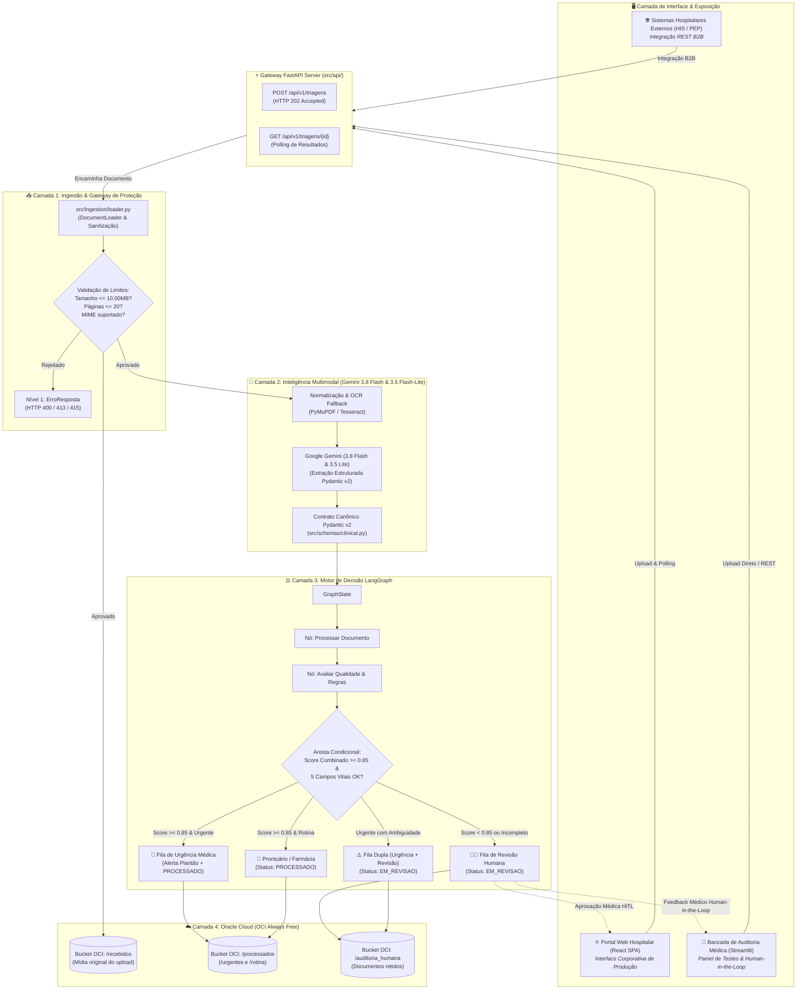
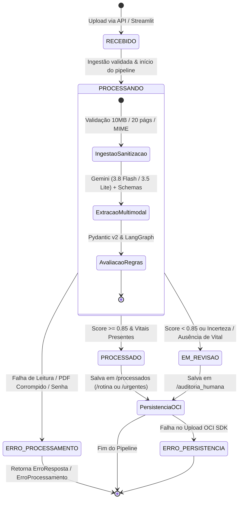

# 🏥 MediFlow: Arquitetura do Sistema e Especificação Técnica

> **Hackathon ONE G10 — Oracle Next Education & Alura**  
> **Projeto 2:** Agente Autônomo para Triagem, Extração e Roteamento de Documentos Clínicos  
> **Equipe 15:** MediFlow  
> **Manual Oficial de Referência:** `34aa946f-2883-4917-aec1-aae0df0f43d1.pdf`  
> **Implementação Central:** [`src/schemas/clinical.py`](src/schemas/clinical.py) | **Suíte de Testes:** 217 testes automatizados via Pytest  

---

## 📌 1. Visão Geral e Contexto da Solução

O **MediFlow** é um agente autônomo inteligente projetado para os setores de **HealthTech, Gestão Hospitalar e Operadoras de Saúde**. Ele automatiza a triagem, a extração estruturada de dados clínicos e o roteamento de documentos heterogêneos (receitas médicas, laudos laboratoriais e de imagem, guias de autorização TISS/TUSS, relatórios de alta e atestados médicos). A solução resolve o problema de atrasos no atendimento emergencial, elimina tarefas manuais repetitivas e reduz custos com glosas hospitalares com estrito rigor regulatório e de segurança.

### 🎯 Matriz de Aderência ao Manual Oficial da Oracle (Projeto 2):

| Requisito do Edital Oracle | Implementação Técnica no MediFlow | Módulo / Código Responsável |
| :--- | :--- | :--- |
| **Ingestão Multimodal (Upload e API REST)** | Suporte a upload de arquivos PDF (digital e escaneado), imagens (JPG, PNG, WEBP) e TXT; integração via API REST com envelopes JSON. Bloqueio estrito de DOCX e outros formatos não suportados (HTTP 415). Limites de segurança: **máximo de 10.00 MB** e **máximo de 20 páginas por documento** (Regra A6). | [`src/ingestion/loader.py`](src/ingestion/loader.py) |
| **Classificação de Tipo Documental** | Classificação automática nas 8 categorias controladas (`RECEITUARIO_MEDICO`, `LAUDO_EXAME_LABORATORIAL`, `LAUDO_EXAME_IMAGEM`, `GUIA_PROCEDIMENTO`, `RELATORIO_ALTA_INTERNACAO`, `ATESTADO_MEDICO`, `OUTRO`, `NAO_IDENTIFICADO`). | [`src/agents/`](src/agents/) |
| **Extração Estruturada com LLM Multimodal** | Extração de entidades clínicas via Google Gemini (modelos `gemini-3.8-flash` e `gemini-3.5-flash-lite`) com *Structured Outputs* nativos via Pydantic v2: Paciente, Médico/CRM com UF paulista/nacional, Diagnóstico/CID-10, Medicamentos (nome, dose, frequência), Exames/Analitos laboratoriais (RF-12) e declaração de urgência. Inclui resiliência REST, timeout de 15s e duplo fallback seguro. | [`src/services/gemini_service.py`](src/services/gemini_service.py), [`src/agents/`](src/agents/) & [`src/schemas/clinical.py`](src/schemas/clinical.py) |
| **Grafo de Decisão Condicional (LangGraph)** | Grafo de estados (`StateGraph`) com nós de extração, validação de regras clínicas e arestas condicionais de roteamento para 5 departamentos. | [`src/workflow/`](src/workflow/) |
| **Tratamento de Urgências e Human-in-the-Loop** | Notificação imediata para a equipe de plantão em casos urgentes e retenção obrigatória em fila de auditoria humana (*Human-in-the-Loop*) em caso de ambiguidade, rasura, campo vital ausente ou score $< 0.85$. | [`src/workflow/edges.py`](src/workflow/edges.py) |
| **Persistência OCI Object Storage (Always Free)** | Organização e segregação de arquivos e metadados em buckets gratuitos da nuvem Oracle (`/recebidos`, `/processados/urgentes`, `/processados/rotina`, `/auditoria_humana`). | [`src/storage/`](src/storage/) |
| **Demonstração dos 3 Cenários Obrigatórios** | Cobertura comprovada por testes e dados sintéticos: (1) Fluxo Padrão de Rotina, (2) Urgência Médica (TEP Agudo), (3) Caso Ambíguo para Revisão Humana. | [`tests/fixtures/demo/`](tests/fixtures/demo/) |
| **Diferenciais Implementados** | Interface web em Streamlit para Human-in-the-Loop, OCR fallback, detecção de doses terapêuticas anômalas e governança com 79 fixtures oficiais. | [`src/app/`](src/app/), [`src/workflow/graph.py`](src/workflow/graph.py) & [`src/schemas/clinical.py`](src/schemas/clinical.py) |

---

## 🏗️ 2. Diagrama de Arquitetura em Camadas

O MediFlow é estruturado em 5 camadas funcionais desacopladas e auditáveis:



---

## 🧩 3. Detalhamento das 5 Camadas de Engenharia

### 3.1 Camada 1: Ingestão, Validação e Gateway (`src/ingestion/`)
- **Objetivo:** Blindar a esteira de processamento contra ataques, custos desnecessários com tokens de IA e falhas de leitura.
- **Regras Executadas:**
  - **Tamanho Máximo:** Rejeição imediata de arquivos $> 10.00\text{ MB}$ com HTTP 413 `ARQUIVO_MAIOR_QUE_LIMITE`.
  - **Limite de Páginas:** Rejeição de PDFs com mais de 20 páginas (HTTP 413).
  - **Formatos Aceitos para Upload (Allowlist A6):** `.pdf` (digital e digitalizado), `.txt` e imagens (`.jpg`, `.jpeg`, `.png`, `.webp`).
  - **Integração via API REST:** Envelopes estruturados em `JSON` contendo o payload e texto clínico.
  - **Formatos Bloqueados no Gateway (Negativos Técnicos):** Rejeição imediata com `HTTP 415 FORMATO_NAO_SUPORTADO` para arquivos `.docx`, `.zip`, executáveis ou qualquer extensão fora do allowlist (comprovado pelo teste e fixture `Validacao_ArquivoDocx.docx`).
  - **Tratamento Precoce de Falhas:** Detecção imediata de PDFs com senha (`PDF_PROTEGIDO`) e PDFs ilegíveis/corrompidos (`PDF_CORROMPIDO`), emitindo contratos de erro sem executar inferência.

### 3.2 Camada 2: Inteligência Multimodal e Schemas (`src/services/`, `src/agents/` e `src/schemas/`)
- **Objetivo:** Compreender visualmente o documento e estruturar os dados clínicos com determinismo absoluto e tolerância a falhas.
- **Componentes:**
  - **Serviço Central GeminiService ([`src/services/gemini_service.py`](src/services/gemini_service.py)):**
    - **Protocolo de Rede Resiliente:** Configurado com `genai.configure(transport="rest")` para evitar problemas de socket/gRPC no ambiente Windows.
    - **Timeout Restrito (15s):** Limita as requisições com `request_options={"timeout": 15}` para atender ao requisito de resposta rápida (tempo de triagem < 5s).
    - **Saídas Estruturadas Nativas (Pydantic v2):** Utiliza `response_schema` com `_ClassificacaoDocumentoSchema` e `_DadosClinicosExtraidosSchema`, garantindo validação em tempo de compilação/execução sem alucinação de formato.
    - **Defesa Contra Prompt Injection:** Todo conteúdo documental é envolvido nas tags `<documento_clinico>` e interpretado estritamente como dado passivo.
    - **Duplo Fallback de Alta Disponibilidade:**
      1. *Fallback de Modelos:* Tenta o modelo de nova geração `gemini-3.8-flash` e, em caso de instabilidade, tenta `gemini-3.5-flash-lite`.
      2. *Fallback Clínico (Fail-Safe Seção 12 da E.F. v1.0):* Se houver falha total ou ausência de chave de API, gera `ClassificacaoDocumento(tipo_documento=NAO_IDENTIFICADO, score=0.0)`, des抟ando o documento para `FILA_REVISAO_HUMANA` sem quebrar a API.
  - **Contrato Canônico Pydantic v2 ([`src/schemas/clinical.py`](src/schemas/clinical.py)):** Modelo de dados unificado com validação estrita de tokens, enums resilientes via `_missing_` e suporte a submodelos dedicados (`Paciente`, `Medico`, `Crm`, `ItemExameLaboratorial`, `ConflitoQualidade`).

### 3.3 Camada 3: Motor de Decisão LangGraph (`src/workflow/`)
- **Objetivo:** Garantir a governança do fluxo de decisão de forma auditável e não probabilística.
- **Componentes:**
  - `GraphState`: Estado compartilhado contendo dados brutos, entidades extraídas, qualidade e decisões.
  - **Avaliação de Qualidade e Regras Clínicas** ([`src/workflow/graph.py`](src/workflow/graph.py) e [`src/schemas/clinical.py`](src/schemas/clinical.py)): Motor determinístico que avalia conflitos impeditivos, limites terapêuticos (ex: sobredosagem de fármacos) e inconsistências cadastrais.
  - `Arestas Condicionais`: Decisão matemática entre os 5 destinos do edital.

### 3.4 Camada 4: Armazenamento OCI Always Free (`src/storage/`)
- **Objetivo:** Persistência em nuvem segura em conformidade com as diretrizes do edital da Oracle.
- **Política Always Free:** Utiliza exclusivamente a camada gratuita da Oracle Cloud Infrastructure, segregando objetos em pastas lógicas no bucket `mediflow-documentos-clinicos`.

### 3.5 Camada 5: Apresentação e Integração (Estratégia Dual: React + Streamlit via FastAPI)
A camada de apresentação do MediFlow adota a **Estratégia Dual**, garantindo aderência total ao edital da Oracle e maturidade de engenharia corporativa:

- **Portal Web Corporativo (React SPA — Giovane):**
  - Frontend moderno em React (Single Page Application) desenvolvido para ambiente de produção hospitalar.
  - Interface rica com upload *drag-and-drop*, dashboards de produtividade médica, renderização em alta resolução de laudos e receitas, e tela avançada de triagem clínica.
  - Opera de forma 100% desacoplada, consumindo a API REST assíncrona via HTTP/JSON.

- **Bancada de Triagem & Auditoria Médica (Streamlit — `src/app/streamlit_app.py`):**
  - Painel visual interativo em Python que atende ao diferencial oficial do checklist da Oracle (*"Painel de Auditoria Human-in-the-Loop em Streamlit"*).
  - Funciona como bancada operacional de testes rápidos para a equipe de engenharia e auditores médicos, permitindo inspecionar o JSON estruturado lado a lado com a mídia original.

- **FastAPI REST Gateway Assíncrono (`src/api/`):**
  - Servidor backend padronizado com documentação OpenAPI/Swagger interativa automática (`/docs`).
  - Responde com `HTTP 202 Accepted` em operações assíncronas e gerencia a esteira de Background Tasks, servindo de forma agnóstica tanto ao React quanto ao Streamlit e a sistemas legados hospitalares (HIS/PEP).
  - **Especificação dos Endpoints Oficiais (`/api/v1`):**
    - `POST /api/v1/triagens`: Recebe payloads em JSON (`CriarTriagemTextoRequest`) ou `multipart/form-data` (arquivos até 10MB/20 páginas). Valida integridade e retorna imediatamente `HTTP 202 Accepted` contendo `documento_id`, `status: "RECEBIDO"`, `status_url` e `historico_url`.
    - `GET /api/v1/triagens/{id}`: Retorna o modelo canônico completo [`TriagemMediFlow`](src/schemas/clinical.py) enriquecido com o roteamento do LangGraph e metadados OCI.
    - `GET /api/v1/triagens/{id}/status`: Consulta ultra-leve de polling contendo status (`RECEBIDO`, `PROCESSANDO`, `PROCESSADO`, `EM_REVISAO`, `ERRO_PROCESSAMENTO`), destinos hospitalares e flag de auditoria.
    - `GET /api/v1/triagens/{id}/historico`: Linha do tempo auditável de eventos emitidos durante o ciclo de vida do documento (ingestão, OCR, extração LLM, roteamento LangGraph e OCI).
    - `GET /api/v1/health`: Endpoint de sanidade e liveness probe para orquestradores de contêiner e monitoramento hospitalar.
  - **Blindagem Contra Falhas e Segurança:**
    - Erros de validação HTTP 400, 413, 415 e 422 mapeados para envelopes controlados [`ErroResposta`](src/schemas/clinical.py).
    - Exception handlers globais protegem contra vazamento de stack traces e dados sensíveis (CT-080 da EPT).
    - Decodificação resiliente com suporte automático a UTF-8, Windows-1252 e Latin-1 para terminais hospitalares heterogêneos.

---

## ⚖️ 4. O Grafo de Decisão Clínica (LangGraph) e Ciclo de Vida

### 4.1 Máquina de Estados e Ciclo de Vida da Triagem

O ciclo de vida de qualquer documento processado pelo **MediFlow** transita de forma estrita e rastreável pelos estados controlados pelo enum `StatusTriagem`:



### 4.2 O Grafo de Decisão Clínica (LangGraph)

O fluxo de decisão segue um grafo determinístico modelado com o **LangGraph**:


### 4.3 As 8 Regras Clínicas Determinísticas de Roteamento (R1 a R8):

1. **Regra R1 (Urgência com Alta Confiança):**  
   Urgência bem documentada (`prioridade == URGENTE` ou `urgencia == SIM`), score combinado $\ge 0.85$ e campos vitais completos.  
   ➔ **Destino:** `[FILA_URGENCIA_MEDICA]`, **Status:** `PROCESSADO`, **Auditoria Humana:** `False`, com emissão de alerta imediato.
2. **Regra R2 (Rotina de Alta Confiança - Roteamento por Tipo Documental):**  
   Score combinado $\ge 0.85$, sem pendências vitais e sem urgência.  
   ➔ `RECEITUARIO_MEDICO` $\rightarrow$ `[FARMACIA_HOSPITALAR]`  
   ➔ `GUIA_PROCEDIMENTO` $\rightarrow$ `[AUDITORIA_AUTORIZACOES]`  
   ➔ `LAUDO_EXAME_IMAGEM`, `LAUDO_EXAME_LABORATORIAL`, `RELATORIO_ALTA_INTERNACAO`, `ATESTADO_MEDICO` $\rightarrow$ `[PRONTUARIO_ELETRONICO]`  
   ➔ **Status:** `PROCESSADO`, **Auditoria Humana:** `False`.
3. **Regra R3 (Score Baixo ou Conflitos Impeditivos):**  
   Score combinado $< 0.85$, campos incertos presentes ou conflitos de gravidade `ALTA` ou `MEDIA` (ex.: sobredosagem medicamentosa, CRM inválido).  
   ➔ **Destino:** `[FILA_REVISAO_HUMANA]`, **Status:** `EM_REVISAO`, **Auditoria Humana:** `True`.
4. **Regra R4 (Casos Mistos - Urgência com Ambiguidade ou Ilegibilidade):**  
   Urgência clínica combinada com score baixo, dados truncados ou rasura.  
   ➔ **Destinos Duplos:** `[FILA_URGENCIA_MEDICA, FILA_REVISAO_HUMANA]`, **Status:** `EM_REVISAO`, **Auditoria Humana:** `True`, com disparo de alerta de emergência simultâneo.
5. **Regra R5 (Fórmula Canônica do Score Combinado):**  
   `score_combinado = min(score_classificacao, score_extracao)`  
   As penalidades determinísticas de qualidade (conflitos ALTA: `-0.30`, MEDIA: `-0.20`, BAIXA: `-0.10`, vitais ausentes: `-0.20` e incertezas: `-0.10`) são abatidas no cálculo prévio do `score_extracao` (com piso em `0.0`). Se `score_combinado < 0.85`, a revisão humana é acionada.
6. **Regra R6 (Trava de Segurança dos 5 Campos Vitais - RF-21):**  
   Campos vitais obrigatórios: `paciente.nome`, `paciente.idade`, `medico.nome`, `medico.crm`, `diagnostico` (ou analitos laboratoriais). A ausência de qualquer um deles retém o documento compulsoriamente em `EM_REVISAO`.
7. **Regra R7 (Documentos Não Classificados ou Fora de Escopo):**  
   Tipos `OUTRO`, `NAO_IDENTIFICADO` ou sem mapeamento departamental direto.  
   ➔ **Destino:** `[FILA_REVISAO_HUMANA]`, **Status:** `EM_REVISAO`, **Auditoria Humana:** `True`.
8. **Regra R8 (Garantia de Idempotência e Ponto Fixo):**  
   A revalidação sucessiva de qualquer payload (`TriagemMediFlow.model_validate(obj.model_dump())`) preserva exatamente o mesmo estado, sem oscilações de scores, destinos ou flags.

---

## 📋 5. O Contrato Canônico de Dados (`TriagemMediFlow`)

Abaixo está o payload canônico oficial gerado pelo MediFlow, modelado a partir do exemplo oficial das páginas 4 e 5 do manual da Oracle:

```json
{
  "status": "processado",
  "documento_id": "DOC-CLIN-2026-8942",
  "classificacao": {
    "tipo_documento": "LAUDO_EXAME_IMAGEM",
    "especialidade": ["Radiologia", "Pneumologia"],
    "nivel_prioridade": "URGENTE",
    "score_classificacao": 0.99
  },
  "dados_extraidos": {
    "paciente": {
      "nome": "Carlos Eduardo Mendes",
      "idade": 52,
      "cpf": null
    },
    "medico": {
      "nome": "Dra. Renata Silveira",
      "crm": {
        "numero": "145892",
        "uf": "SP"
      }
    },
    "diagnostico": "Tromboembolismo Pulmonar Agudo (TEP)",
    "cid": "I26.9",
    "exames": ["Tomografia de Tórax com contraste"],
    "medicamentos": [],
    "urgencia": "SIM"
  },
  "qualidade": {
    "score_extracao": 0.98,
    "score_combinado": 0.98,
    "limiar_aplicado": 0.85,
    "campos_ausentes": [],
    "campos_incertos": [],
    "conflitos": []
  },
  "decisao_roteamento": {
    "destino_principal": "FILA_URGENCIA_MEDICA",
    "destinos": ["FILA_URGENCIA_MEDICA"],
    "requer_auditoria_humana": false,
    "justificativa_roteamento": "Achado crítico de alta gravidade (TEP agudo) detectado em paciente sintomático.",
    "notificacao": {
      "canal": "Alerta_Plantao_Medico",
      "mensagem": "ALERTA URGENTE: Laudo crítico de TEP Agudo para paciente Carlos Eduardo Mendes no Pronto-Socorro."
    }
  },
  "armazenamento_oci": {
    "bucket": "mediflow-documentos-clinicos",
    "caminho_objeto": "processados/urgentes/DOC-CLIN-2026-8942.json",
    "status_backup": "sucesso"
  },
  "erro": null
}
```

---

## ☁️ 6. Topologia de Armazenamento OCI (Always Free)

A persistência em nuvem é operada pelo conector [`src/storage/oci_storage.py`](src/storage/oci_storage.py), construído sobre o SDK oficial da Oracle Cloud (`oci.object_storage.ObjectStorageClient`). O conector aplica:
- **Proteção contra sobrescrita:** Header `if-none-match: *` em `enviar_bytes()` para garantir idempotência e impedir perda de dados.
- **Validação de tipos e tamanho:** Tratamento de buffers binários com `content_type` apropriado.
- **Paginação de listagem:** Itera todas as páginas usando cursor (`next_start_with`).
- **Resiliência a falhas (`ERRO_PERSISTENCIA`):** Se a chamada OCI falhar por indisponibilidade, o sistema registra `CodigoErro.ERRO_PERSISTENCIA` sem anular a decisão de triagem clínica prévia.

A segregação dos documentos no bucket `mediflow-documentos` obedece à hierarquia abaixo:

```text
mediflow-documentos/ (Bucket OCI Always Free - Tenancy izapalomaa)
│
├── recebidos/                                  <- Mídia original no momento do upload (PDF/JPG/TXT)
│   ├── DOC-CLIN-2026-8942.pdf
│   └── DOC-A757DAD2.jpg
│
├── processados/                                <- Documentos triados com sucesso
│   ├── urgentes/                               <- Encaminhados para plantão médico de urgência
│   │   └── DOC-CLIN-2026-8942.json
│   └── rotina/                                 <- Prontuário Eletrônico, Farmácia e Auditoria TISS
│       └── DOC-B1234567.json
│
└── auditoria_humana/                           <- Documentos retidos para revisão (Human-in-the-Loop)
    ├── baixa_confianca/                        <- Score combinado < 0.85 ou rasuras
    └── dados_incompletos/                      <- Ausência de CRM, médico ou hipótese diagnóstica
```

---

## 🧪 7. Engenharia de Qualidade e Suíte de Testes (217 Testes)

A conformidade do MediFlow com os requisitos funcionais e com o edital da Oracle é auditada por uma suíte de 217 testes automatizados no Pytest:

| Módulo de Teste | Quantidade | Escopo e Cobertura Técnica |
| :--- | :---: | :--- |
| **`tests/test_contrato_fixtures.py`** | **79 testes** | Validação canônica dos 79 fixtures oficiais (William) contra o modelo Pydantic v2 e regras R1 a R8 (consistência de ponto fixo determinístico). |
| **`tests/test_workflow.py`** | **73 testes** | Grafo LangGraph completo, nós de decisão, arestas condicionais, avaliação de score e roteamento para os 5 destinos. |
| **`tests/test_ingestion.py`** | **18 testes** | Ingestão robusta, validação de arquivos físicos (.pdf, .jpg, .webp, rejeição de .docx), limites estritos de 10.00MB e 20 páginas, PDFs protegidos e corrompidos. |
| **`tests/test_api.py`** | **16 testes** | Endpoints REST FastAPI assíncronos (HTTP 202), validações de erro (400, 415, 422), polling de status, histórico e health check (EPT CT-001 a CT-080). |
| **`tests/test_gemini_service.py`** | **9 testes** | Testes unitários do GeminiService: transporte REST, timeout de 15s, Saída Estruturada Pydantic v2, duplo fallback e fail-safe sem chave. |
| **`tests/test_oci_storage.py`** | **8 testes** | Conector OCI Object Storage simulado (mock), validação de `if-none-match`, preservação de bytes, paginação e propagação de erros. |
| **`tests/test_audit_items.py`** | **8 testes** | Auditoria clínica de sanidade: descarte de diagnóstico restrito a lab, urgência indeterminada, persistência e sanitização. |
| **`tests/test_schemas.py`** | **7 testes** | Schemas Pydantic v2, serialização JSON, aliases de retrocompatibilidade e tratamento de erros de Nível 1 e 2. |
| **Total da Suíte Oficial** | **217 testes** | **100% aprovados em ~5.7s (1 skipped esperado de isolamento legado)** |

---

## 🚀 8. Guia de Execução Local e Demonstração

```bash
# 1. Acessar o diretório do projeto
cd g10-brasil-equipe-15_mediflow

# 2. Criar e ativar o ambiente virtual Python (3.11 ou superior)
python -m venv .venv
# Windows:
.venv\Scripts\activate
# Linux/Mac:
source .venv/bin/activate

# 3. Instalar as dependências oficiais
pip install -r requirements.txt

# 4. Configurar as chaves de ambiente
cp .env.example .env
# Configurar GEMINI_API_KEY e credenciais OCI Always Free

# 5. Executar a suíte completa de 217 testes automatizados
python -m pytest

# 6. Testes Manuais Opcionais (Cloud OCI e IA Gemini)
python -m scripts.testar_oci
python testar_gemini.py

# 7. Opção A: Iniciar o Servidor FastAPI (Backend REST para React e API)
uvicorn src.api.main:app --reload --port 8000

# 8. Opção B: Iniciar a Bancada Streamlit (Auditoria Rápida & HiTL)
streamlit run src/app/streamlit_app.py
```

---

## 📁 9. Estrutura de Diretórios & Organização do Repositório

### 9.1 Árvore Oficial Atual (Backend, IA, Nuvem & Testes)

```text
g10-brasil-equipe-15_mediflow/
├── data/
│   └── samples/                                <- Amostras clínicas dos 3 cenários do edital
│       ├── 01_cenario_rotina.json              <- RX Tórax normal (Rotina ambulatorial)
│       ├── 01_laudo_rotina.pdf                 <- PDF digital de rotina
│       ├── 02_cenario_urgencia.json            <- TEP Agudo I26.9 (Urgência com alerta)
│       ├── 02_laudo_urgencia_tep.pdf           <- PDF digital de urgência
│       └── 03_cenario_ambiguidade.json         <- Receita com dose anômala (Revisão humana)
│
├── docs/                                       <- Documentação técnica e governança de QA
│   ├── testes/                                 <- Central de Engenharia de Qualidade
│   │   ├── CONTRATO_DE_DADOS.md                <- Contrato canônico unificado (fonte da verdade)
│   │   ├── CATALOGO_DE_DOCUMENTOS_DE_TESTE.md  <- Catálogo completo dos 79 fixtures
│   │   ├── AUDITORIA_2026-10-20.md             <- Histórico de resolução de pendências
│   │   ├── VISUAL_SCHEMAS.md                   <- Guia visual com diagramas Mermaid autoritativos
│   │   ├── Mapa_de_Documentos_de_Teste_MediFlow.pdf <- Matriz visual de rastreabilidade (PDF)
│   │   └── README.md                           <- Guia de navegação de testes e QA
│   └── GUIA_INTEGRACAO_LLM.md                  <- Guia de consumo do Ingestion Loader para IA
│
├── src/                                        <- Código-fonte da aplicação (Python Backend & IA)
│   ├── agents/                                 <- Agentes e Prompts de Inteligência Multimodal
│   ├── api/                                    <- API REST FastAPI Assíncrona (/api/v1/triagens)
│   ├── app/                                    <- Interfaces Python (Streamlit HiTL)
│   │   └── streamlit_app.py                    <- Painel web de auditoria médica e testes rápidos
│   ├── ingestion/                              <- Camada de Ingestão e Gateway de Segurança
│   │   └── loader.py                           <- Carregador blindado (10MB, 20 págs, MIME, magic bytes)
│   ├── schemas/                                <- Modelos de Dados Pydantic v2
│   │   └── clinical.py                         <- Schemas canônicos (TriagemMediFlow, ErroResposta, etc.)
│   ├── services/                               <- Serviços de Integração Multimodal
│   │   └── gemini_service.py                   <- GeminiService estruturado (REST, 15s, Pydantic v2, duplo fallback)
│   ├── storage/                                <- Conector OCI Object Storage Always Free (oci_storage.py)
│   ├── workflow/                               <- Motor de Orquestração Determinística (LangGraph)
│   │   ├── graph.py                            <- Grafo de estados, nós e cálculo de regras
│   │   └── state.py                            <- Estrutura do GraphState compartilhado
│   └── config.py                               <- Configurações globais e variáveis de ambiente
│
├── scripts/                                    <- Utilitários de homologação e scripts de diagnóstico
│   └── testar_oci.py                           <- Validação real ponta a ponta no bucket OCI Always Free
│
├── tests/                                      <- Suíte Oficial de Testes Automatizados (217 testes)
│   ├── test_contrato_fixtures.py               <- 79 testes: ponto fixo dos fixtures e regras R1 a R8
│   ├── test_workflow.py                        <- 73 testes: transições e arestas do LangGraph
│   ├── test_ingestion.py                       <- 18 testes: arquivos reais, PDF, JPG, WEBP e DOCX (415)
│   ├── test_api.py                             <- 16 testes: endpoints REST FastAPI e EPT
│   ├── test_gemini_service.py                  <- 9 testes unitários do GeminiService (REST, 15s e fallback)
│   ├── test_audit_items.py                     <- 8 testes dedicados de auditoria técnica e sanidade
│   ├── test_oci_storage.py                     <- 8 testes: persistência OCI com SDK simulado (mock)
│   ├── test_schemas.py                         <- 7 testes: Pydantic v2 e envelopes de erro Nível 1 e 2
│   └── fixtures/                               <- Base de 79 fixtures canônicos
│       ├── demo/                               <- 12 casos essenciais para o pitch (TXT, PDF, JPG, JSON)
│       ├── catalogo/                           <- 67 casos avançados (qualidade, borda, limites)
│       └── manifest.csv                        <- Rastreabilidade formal em formato de máquina
│
├── testar_gemini.py                            <- Script de validação manual da IA com Google Gemini
├── ARQUITETURA.md                              <- Especificação Técnica Oficial da Arquitetura
├── README.md                                   <- Documentação Principal do Repositório
├── pytest.ini                                  <- Configuração corporativa do Pytest
├── requirements.txt                            <- Dependências oficiais do ecossistema Python
└── .env.example                                <- Modelo de chaves (Gemini API e OCI Always Free)
```

---

### 9.2 Sugestão Arquitetural para o Frontend React (`frontend/`)

Para manter o desacoplamento arquitetural e permitir que **Giovane Brandino** desenvolva a Single Page Application (SPA) em React com máxima produtividade e sem misturar dependências do Node.js com o Python, recomenda-se a seguinte estrutura de pastas na raiz do projeto:

```text
frontend/                                       <- Aplicação Web Corporativa (React SPA — Giovane Brandino)
├── public/                                     <- Assets estáticos públicos (favicons, logos hospitalares)
├── src/
│   ├── assets/                                 <- Imagens, ícones médicos SVG e estilos
│   ├── components/                             <- Componentes de UI modulares e reutilizáveis
│   │   ├── common/                             <- Botões, Badges de Status, Modais, Spinners de Loading
│   │   ├── triage/                             <- CardTriagem, ScoreBadge, TabelaMedicamentos, AlertaUrgencia
│   │   ├── viewer/                             <- Visualizador de PDF e Imagens Lado a Lado
│   │   └── upload/                             <- Dropzone com validação prévia de tamanho (10MB no client)
│   ├── hooks/                                  <- Custom React Hooks
│   │   ├── useTriage.ts                        <- Disparo de triagem e controle de requisições
│   │   └── usePolling.ts                       <- Polling assíncrono para GET /api/v1/triagens/{id}
│   ├── pages/                                  <- Telas / Rotas da Aplicação
│   │   ├── HomePage.tsx                        <- Apresentação e visão geral do MediFlow
│   │   ├── UploadPage.tsx                      <- Tela de envio e pré-visualização de documentos
│   │   ├── DashboardPage.tsx                   <- Visão geral das filas hospitalares (Kanban de triagem)
│   │   └── AuditPage.tsx                       <- Bancada Human-in-the-Loop para casos EM_REVISAO
│   ├── services/                               <- Camada de Comunicação com o Backend
│   │   └── api.ts                              <- Cliente Axios configurado para a API FastAPI
│   ├── types/                                  <- Tipagens TypeScript sincronizadas com o Contrato
│   │   └── clinical.ts                         <- Interface TriagemMediFlow, Enums, ErroResposta
│   ├── styles/                                 <- Configurações de TailwindCSS e temas visuais
│   ├── App.tsx                                 <- Gerenciador de rotas e layout global
│   └── main.tsx                                <- Ponto de entrada da aplicação
├── package.json                                <- Dependências do ecossistema Node/React (Vite, Axios, Tailwind)
├── vite.config.ts                              <- Configuração do bundler Vite (com proxy para http://localhost:8000)
├── tailwind.config.js                          <- Design System médico (paleta: azul, verde, vermelho de alerta)
└── README.md                                   <- Guia rápido de instalação (npm install && npm run dev)
```

