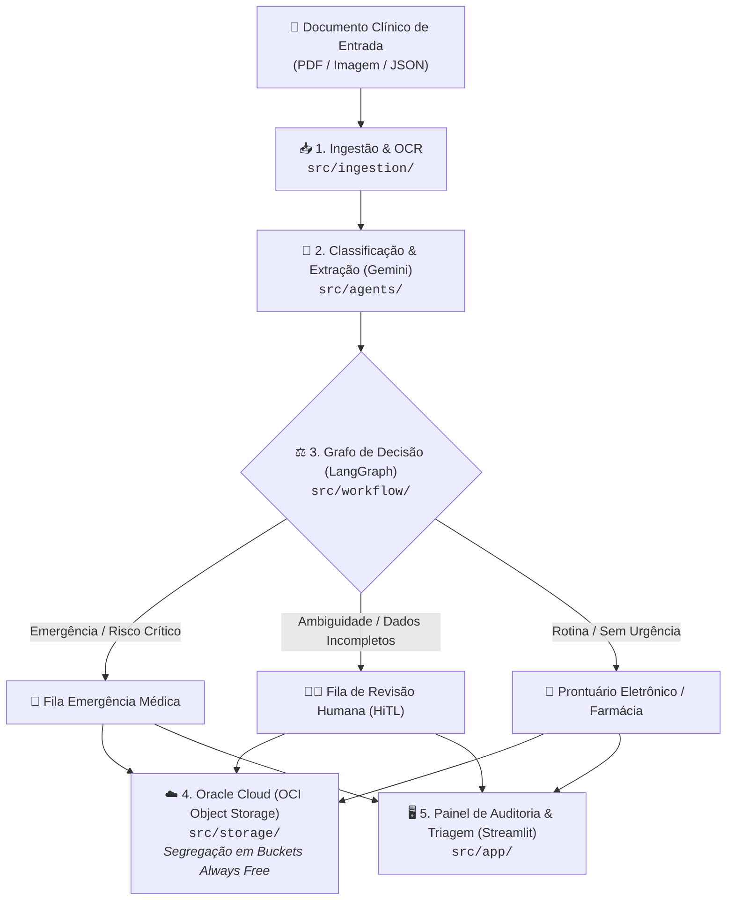

# 🏥 MediFlow: Arquitetura Base & Guia de Desenvolvimento

> **Hackathon ONE G10 — Oracle Next Education & Alura**  
> **Equipe 15 | Projeto 2: Agente Autônomo para Triagem, Extração e Roteamento de Documentos Clínicos**

---

## 📌 1. Visão Geral da Arquitetura

O **MediFlow** processa documentos clínicos heterogêneos (laudos médicos, receitas, guias TISS/TUSS, atestados) através de um pipeline inteligente de 5 etapas. Todos os módulos operam sob um **contrato de dados unificado** em Pydantic:



---

## 📋 2. O Contrato de Dados Central (`src/schemas/clinical.py`)

Para que todos os integrantes desenvolvam suas partes em paralelo sem desencontro de formatos, todos os módulos consomem e produzem o schema oficial **`ResultadoTriagemClinica`**:

```python
from src.schemas import (
    ResultadoTriagemClinica,
    ClassificacaoClinica,
    DadosExtraidos,
    DecisaoRoteamento,
    NivelPrioridade,
    DestinoRoteamento
)
```

### Estrutura do Payload:
```json
{
  "status": "processado",
  "documento_id": "DOC-CLIN-2026-8942",
  "canal_origem": "Pronto_Socorro",
  "classificacao": {
    "tipo_documento": "Laudo de Exame de Imagem",
    "especialidade": "Radiologia / Pneumologia",
    "nivel_prioridade": "Urgente",
    "score_confianca_classificacao": 0.99
  },
  "dados_extraidos": {
    "paciente": { "nome": "Carlos Eduardo Mendes", "idade": 52 },
    "medico_solicitante": { "nome": "Dra. Renata Silveira", "crm": "145892-SP" },
    "exame_realizado": "Tomografia de Torax com contraste",
    "diagnostico_principal": "Tromboembolismo Pulmonar Agudo (TEP)",
    "cid_sugerido": "I26.9"
  },
  "decisao_roteamento": {
    "destino_principal": "Fila_Emergencia_Medica",
    "requer_auditoria_humana": false,
    "justificativa_roteamento": "Achado critico de alta gravidade (TEP agudo) detectado em paciente sintomatico.",
    "notificacao_gerada": {
      "canal": "Alerta_Plantao_Medico",
      "mensagem": "ALERTA URGENTE: Laudo critico de TEP Agudo para paciente Carlos Eduardo Mendes no Pronto-Socorro."
    }
  },
  "armazenamento_oci": {
    "bucket": "mediflow-documentos-clinicos",
    "caminho_objeto": "processados/urgentes/DOC-CLIN-2026-8942.json",
    "status_backup": "sucesso"
  }
}
```

---

## 👥 3. Frentes de Trabalho & Organização da Equipe

A equipe de 7 a 8 pessoas está dividida em **5 frentes modulares**. Cada frente atua dentro de sua própria pasta no projeto:

| Frente | Pasta Responsável | Branch Sugerida | O que deve ser implementado |
|---|---|---|---|
| **1. Ingestão & OCR** | `src/ingestion/` | `feature/ingestao-documentos` | Leitura de PDFs e imagens (PyMuPDF / OCR), extraindo texto limpo e metadados brutos. |
| **2. LLM & Extração** | `src/agents/` | `feature/extracao-gemini` | Prompts com Google Gemini utilizando `response_schema` do Pydantic para preencher a classificação e as entidades clínicas. |
| **3. LangGraph & Decisão** | `src/workflow/` | `feature/grafo-langgraph` | Implementação do grafo condicional (LangGraph StateGraph), avaliando score de confiança e roteando para emergência ou *Human-in-the-Loop*. |
| **4. Nuvem Oracle (OCI)** | `src/storage/` | `feature/integracao-oci` | Cliente OCI Object Storage (Always Free) para upload dos JSONs e PDFs nas pastas `processados/urgentes/`, `rotina/` e `auditoria/`. |
| **5. Interface (UI)** | `src/app/` | `feature/interface-usuario` | Painel web (Streamlit) para upload de documentos, cards de triagem visual e tela de auditoria médica. |
| **Transversal: QA & Docs** | `tests/` e docs | `docs/testes-e-arquitetura` | Testes automatizados dos 3 cenários do edital, gravação do pitch e refinamento da documentação. |

---

## 📁 4. Amostras Clínicas dos 3 Cenários Exigidos

O edital exige a demonstração de no mínimo 3 cenários. Eles já estão disponíveis em `data/samples/` para você testar sua funcionalidade:

1. `data/samples/01_cenario_rotina.json`: Exame ambulatorial normal (Paciente assintomático, rotina preventiva).
2. `data/samples/02_cenario_urgencia.json`: Tromboembolismo Pulmonar Agudo (TEP crítico exigindo alerta imediato).
3. `data/samples/03_cenario_ambiguidade.json`: Receita ilegível, opioide com dosagem ambígua e sem CRM (aciona a revisão humana).

---

## ⚡ 5. Guia Rápido: Como Executar o Projeto Localmente

```bash
# 1. Garanta que está com a develop atualizada
git checkout develop
git pull origin develop

# 2. Crie e ative seu ambiente virtual Python
python -m venv .venv

# Windows:
.venv\Scripts\activate
# Linux/Mac:
source .venv/bin/activate

# 3. Instale as dependências oficiais
pip install -r requirements.txt

# 4. Configure o arquivo de variáveis de ambiente
# Copie o .env.example para .env e preencha suas chaves
cp .env.example .env

# 5. Rode os testes unitários automatizados
pytest tests/
# Resultado esperado: 2 passed in 0.43s ✅
```

---

## 🛡️ 6. Regras de Colaboração Git
- **Nunca dê push direto na `develop` ou `main`** (as branches estão protegidas por regras de proteção).
- Sempre crie sua branch: `git checkout -b feature/sua-frente`.
- Abra um Pull Request apontando para a `develop`.
- Peça para pelo menos **1 colega da equipe aprovar (Approve)** para realizar o Merge.
