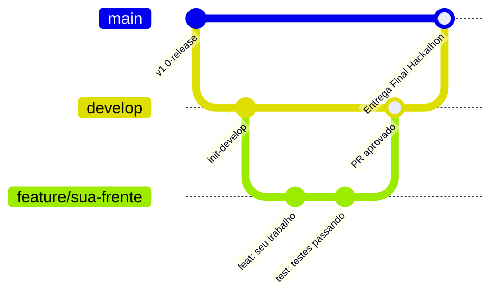

# 🤝 Guia de Colaboração e Engenharia de Software — Equipe 15 MediFlow

> **Hackathon ONE G10 — Oracle Next Education & Alura**  
> **Projeto 2:** Agente Autônomo para Triagem, Extração e Roteamento de Documentos Clínicos  
> **Manual de Referência:** `34aa946f-2883-4917-aec1-aae0df0f43d1.pdf`  
> **Status da Aplicação:** 150 testes automatizados via Pytest  

Bem-vindo ao guia oficial de contribuição do **MediFlow**! Este documento foi desenhado para orientar os 8 integrantes da equipe no fluxo de trabalho diário com GitFlow, organização de pastas, responsabilidades por módulo e padrões de qualidade inegociáveis.

---

## 🌳 1. Arquitetura de Branches (GitFlow Simplificado)

Para evitar conflitos de código e garantir estabilidade, utilizamos o **Feature Branch Workflow**:



| Branch | Papel no Projeto | Regra de Proteção & Acesso |
| :--- | :--- | :--- |
| **`main`** | Código de produção, congelado para avaliação da banca da Oracle. | **Totalmente Protegida**. Pushes diretos bloqueados. Merge somente via PR vindo de `develop`. |
| **`develop`** | Branch padrão (*default*). Onde todas as frentes integradas convivem. | **Protegida**. Pushes diretos bloqueados. Merge somente via Pull Request aprovado por pelo menos 1 colega. |
| **`feature/*`** | Desenvolvimento de novas funcionalidades ou módulos. | Criada a partir de `develop` e mesclada de volta via Pull Request. |
| **`fix/*`** | Correção de bugs pontuais identificados na `develop`. | Criada a partir de `develop` e mesclada de volta via Pull Request. |
| **`docs/*`** | Atualizações exclusivas de documentação, guias e diagramas. | Criada a partir de `develop` e mesclada de volta via Pull Request. |

---

## 📁 2. Mapa do Repositório: Onde Implementar Cada Coisa

Antes de criar qualquer arquivo novo, consulte a árvore oficial para colocar seu código no lugar correto:

```text
g10-brasil-equipe-15_mediflow/
├── data/
│   └── samples/                                <- Amostras clínicas dos 3 cenários do edital (PDF/JSON)
├── docs/                                       <- Documentação técnica e governança de QA
│   ├── testes/                                 <- Contrato Canônico, Catálogo dos 79 Fixtures e Auditorias
│   └── GUIA_INTEGRACAO_LLM.md                  <- Guia de consumo do Ingestion Loader para IA
│
├── src/                                        <- Código-fonte principal da aplicação Python
│   ├── agents/                                 <- Agentes LLM Multimodais (Google Gemini 1.5 e Prompts)
│   ├── app/                                    <- Bancada Streamlit de testes rápidos e auditoria médica (HiTL)
│   │   └── streamlit_app.py                    <- Painel web visual interativo
│   ├── ingestion/                              <- Camada de Ingestão e Gateway de Segurança
│   │   └── loader.py                           <- Carregador blindado (10MB, 20 págs, sanitização e allowlist)
│   ├── schemas/                                <- Modelos Canônicos Pydantic v2
│   │   └── clinical.py                         <- Contrato oficial (TriagemMediFlow, ErroResposta, etc.)
│   ├── storage/                                <- Integração com Oracle Cloud Infrastructure (OCI Always Free)
│   ├── workflow/                               <- Motor de Orquestração Determinística (LangGraph)
│   │   ├── graph.py                            <- Grafo de estados, nós e cálculo de regras R1 a R8
│   │   └── state.py                            <- Estrutura do GraphState compartilhado
│   └── config.py                               <- Configurações globais e leitura do .env
│
├── tests/                                      <- Suíte Oficial Pytest com 150 testes automatizados
│   ├── fixtures/                               <- Base de 79 fixtures canônicos (demo, catalogo, manifest.csv)
│   ├── test_contrato_fixtures.py               <- 79 testes: ponto fixo dos fixtures e regras R1 a R8
│   ├── test_workflow.py                        <- 46 testes: transições e arestas do LangGraph
│   ├── test_ingestion.py                       <- 18 testes: arquivos físicos reais e limites
│   └── test_schemas.py                         <- 7 testes: Pydantic v2 e envelopes de erro
│
├── frontend/                                   <- Portal Web Corporativo em React SPA (Vite + TypeScript)
├── ARQUITETURA.md                              <- Especificação Técnica Oficial da Arquitetura
├── CONTRIBUTING.md                             <- Este Guia de Colaboração e GitFlow
├── README.md                                   <- Documentação Principal da Aplicação
├── pytest.ini                                  <- Configuração corporativa do Pytest
└── requirements.txt                            <- Dependências oficiais do ecossistema Python
```

---

## 📊 3. Matriz de Funcionalidades: Status do Projeto & Responsáveis

Esta tabela mapeia o que já está homologado no projeto e o que ainda precisa ser entregue para o hackathon:

| Funcionalidade Requisitada (Edital Oracle) | Diretório Responsável | Responsável na Equipe | Status Atual | Detalhes da Entrega / Próximos Passos |
| :--- | :--- | :--- | :---: | :--- |
| **Ingestão & Sanitização de Arquivos** | [`src/ingestion/loader.py`](src/ingestion/loader.py) | **Cristiano Oliveira** | <mark>🟢 CONCLUÍDO</mark> | 100% blindado (10MB, 20 págs, PDF, TXT, JPG, PNG, WEBP e bloqueio de DOCX com 415). 18 testes unitários. |
| **Contrato Canônico Pydantic v2 & Fixtures** | [`src/schemas/clinical.py`](src/schemas/clinical.py) & `docs/testes/` | **William e Luciana** | <mark>🟢 CONCLUÍDO</mark> | Schemas unificados (`TriagemMediFlow`, RF-12, enums resilientes `_missing_`), 79 fixtures canônicos validados e ponto fixo. |
| **Motor de Decisão Clínica LangGraph** | [`src/workflow/`](src/workflow/) | **Iza Paloma M. Coelho** | <mark>🟢 CONCLUÍDO</mark> | Grafo de estados, nós de processamento, regras R1 a R8 e arestas para 5 destinos e casos mistos. 46 testes. |
| **Bancada de Auditoria Médica Streamlit** | [`src/app/streamlit_app.py`](src/app/streamlit_app.py) | **Cristiano Oliveira e Time** | <mark>🟢 CONCLUÍDO</mark> | Painel funcional em Python para testes rápidos de laboratório e auditoria HiTL (atende ao diferencial do edital). |
| **Agente Gemini Multimodal (Extração IA)** | [`src/agents/`](src/agents/) | **Luciana e Iza** | <mark>🟡 EM ANDAMENTO</mark> | **A fazer:** Implementar chamadas à API Gemini 1.5 com *Structured Outputs* orientadas por `src/schemas/clinical.py`. |
| **Persistência OCI Object Storage Always Free** | [`src/storage/`](src/storage/) | **Iza (com apoio a definir)** | <mark>🟡 EM ANDAMENTO</mark> | **A fazer:** Conectar SDK OCI em Python para upload automático nos buckets `/recebidos`, `/processados` e `/auditoria_humana`. |
| **API REST FastAPI Assíncrona** | [`src/api/`](src/api/) | **Cristiano Oliveira e/ou Giovane Brandino** | <mark>🟡 EM ANDAMENTO</mark> | **A fazer:** Implementar rotas `POST /api/v1/triagens` (HTTP 202) e `GET /api/v1/triagens/{id}` para conectar o backend. |
| **Portal Web Corporativo em React SPA** | `frontend/` | **Giovane Brandino e Victor Marcelo** | <mark>⚪ PENDENTE</mark> | **A fazer:** Criar projeto Vite + React + TypeScript + Tailwind consumindo os endpoints da API FastAPI. |
| **Gravação do Pitch e Demonstração Final** | Raiz / Docs | **Luciana e Toda a Equipe** | <mark>⚪ PENDENTE</mark> | **A fazer:** Gravar vídeo de até 5 min demonstrando os 3 cenários clínicos do edital e gerar links de entrega. |

---

## 🚀 4. Ciclo de Trabalho Diário (Passo a Passo)

Sempre que você for trabalhar em uma tarefa, siga religiosamente estes passos:

### Passo 1: Atualizar sua branch `develop` local
Nunca comece a codificar em uma base desatualizada:
```bash
git checkout develop
git pull origin develop
```

### Passo 2: Criar uma branch de trabalho
Crie uma branch com nome semântico indicando o que você fará:
```bash
# Para novas funcionalidades:
git checkout -b feature/nome-da-sua-tarefa

# Para correções de bugs:
git checkout -b fix/descricao-do-bug

# Para documentação:
git checkout -b docs/atualizacao-especifica
```

### Passo 3: Codificar e Commitar (Conventional Commits)
Faça alterações atômicas e utilize mensagens descritivas:
```bash
git add -A
git commit -m "tipo(escopo): descrição da alteração no imperativo"
```
**Prefixos obrigatórios:**
- `feat:` Nova funcionalidade (ex: `feat(agents): adiciona extracao gemini multimodal`)
- `fix:` Correção de bug (ex: `fix(schemas): ajusta validacao de crm`)
- `docs:` Alteração em documentações (ex: `docs(arquitetura): atualiza matriz de tarefas`)
- `test:` Adição ou modificação de testes (ex: `test(ingestion): adiciona teste para webp`)
- `refactor:` Refatoração interna de código sem alteração funcional

### Passo 4: Executar o Quality Gate Obrigatório (Testes)
**Regra Inegociável:** Antes de enviar seu código para o GitHub, rode a suíte completa de testes:
```bash
python -m pytest
```
> ⚠️ **Nenhum Pull Request será aceito se algum dos 150 testes estiver falhando.**

### Passo 5: Enviar as alterações para o GitHub
```bash
git push origin feature/nome-da-sua-tarefa
```

### Passo 6: Abrir e Revisar o Pull Request (PR)
1. Acesse o GitHub e abra um Pull Request com destino (**base**) para a branch **`develop`** (nunca para a `main`).
2. Descreva o que foi feito e marque os colegas responsáveis para revisão.
3. **Pelo menos 1 integrante da equipe deve revisar e dar "Approve"** para que o merge seja autorizado.
4. Após o merge, exclua a branch remota no botão do GitHub para manter o repositório limpo.

---

## 🛡️ 5. Governança do Contrato de Dados (`src/schemas/clinical.py`)

O arquivo [`src/schemas/clinical.py`](src/schemas/clinical.py) é a **fonte única da verdade** do MediFlow. Ele é compartilhado entre a Ingestão, o Agente Gemini, o LangGraph, a OCI, a API FastAPI e as interfaces (Streamlit e React).

- **Proibido alterar campos ou tipos unilateralmente:** Qualquer alteração no schema ou nos enums deve ser discutida previamente com a equipe e refletida em [`docs/testes/CONTRATO_DE_DADOS.md`](docs/testes/CONTRATO_DE_DADOS.md).
- **Resiliência via `_missing_`:** Se precisar aceitar novos formatos de texto vindos de fora, utilize a normalização resiliente já implementada nos Enums, sem alterar os tokens oficiais em caixa alta.

---

## 🔒 6. Regras de Segurança e Boas Práticas

1. **Nunca suba chaves de API ou credenciais:** Chaves como `GEMINI_API_KEY`, chaves privadas OCI (`*.pem`) ou senhas devem residir exclusivamente no seu arquivo local `.env` (que já está blindado no `.gitignore`).
2. **Nunca use `git push --force`** nas branches compartilhadas (`develop` ou `main`).
3. **Mantenha os PRs enxutos:** Pull Requests focados em uma única responsabilidade são aprovados e integrados com muito mais rapidez e segurança.
