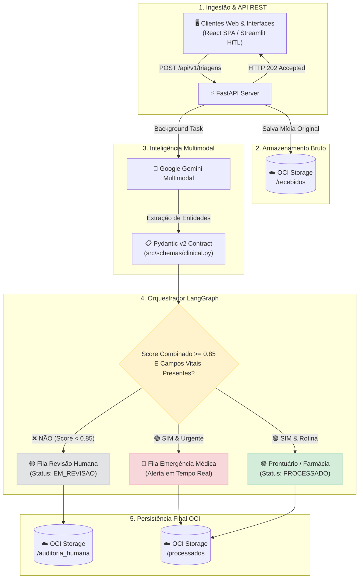

<div align="center">

  <h1> MediFlow: Agente Autônomo para Triagem Clínica</h1>
  <p><b>Triagem, Extração e Roteamento Inteligente de Documentos Médicos com IA Multimodal</b></p>

  <!-- BADGES SHIELDS.IO -->
  <p>
    <a href="#-equipe-15---hackathon-one-g10"></a>
    <a href="#-tecnologias-e-stack"></a>
    <a href="#-tecnologias-e-stack"></a>
    <a href="#-tecnologias-e-stack"></a>
    <a href="#-tecnologias-e-stack"></a>
    <a href="#-tecnologias-e-stack"></a>
    <a href="#-status-do-projeto"></a>
  </p>

  <p>
    <a href="#-visão-geral-do-problema-e-solução">Visão Geral</a> •
    <a href="#-principais-funcionalidades">Funcionalidades</a> •
    <a href="#-arquitetura-e-fluxo-de-dados">Arquitetura</a> •
    <a href="#-cenários-de-demonstração">Cenários de Teste</a> •
    <a href="#-endpoints-da-api-rest">API</a> •
    <a href="#-estrutura-do-repositório">Estrutura</a> •
    <a href="#-equipe-15---hackathon-one-g10">Time</a> •
    <a href="#-como-executar-o-projeto-localmente">Como Rodar</a> •
    <a href="ARQUITETURA.md"><b>Guia de Arquitetura</b></a>
  </p>

  ---
</div>

> [!NOTE]
> **Hackathon ONE G10 - BRASIL**: O **MediFlow** foi desenvolvido para eliminar gargalos de digitação e triagem manual em hospitais e operadoras de saúde, reduzindo o tempo de atendimento de **15 minutos para menos de 5 segundos** por documento.

---

## 📌 Visão Geral do Problema e Solução

O processamento manual de documentos clínicos representa um gargalo financeiro e operacional crítico no setor de saúde, resultando em:

- ⏳ **Lentidão na triagem de urgências:** Atrasos no encaminhamento de achados críticos (ex.: *Tromboembolismo Pulmonar Agudo*).
- 💸 **Elevado custo administrativo:** Dependência de auditoria manual para validação de guias e autorizações.
- ❌ **Glosas médicas e retrabalho:** Inconsistências causadas por erro de digitação de CRM, dosagens ou identificação do paciente.

O **MediFlow** atua como um **Agente Autônomo Multimodal** que lê documentos clínicos em múltiplos formatos (`PDF`, `PNG`, `JPG`, `TXT`), extrai entidades estruturadas com validação estrita via **Pydantic v2**, calcula scores de confiança combinada e executa o roteamento condicional inteligente via **LangGraph**, persistindo os dados na nuvem **Oracle Cloud Infrastructure (OCI Object Storage)**.

---

## ⚡ Principais Funcionalidades

| Ícone | Funcionalidade | Descrição Técnica |
| :---: | :--- | :--- |
| 🚀 | **Ingestão Blindada & Assíncrona** | Validação estrita de limites de segurança (**10.00MB** e **20 páginas** - Regra A6). Suporte a PDF, TXT e Imagens (JPG, PNG, WEBP), com rejeição imediata de DOCX (HTTP 415) e resposta assíncrona (`HTTP 202 Accepted`). |
| 🛡️ | **Contratos Estritos Pydantic v2** | Separação entre os 5 campos vitais (*Paciente, Idade, Médico, CRM, Diagnóstico*) e campos neutros, garantindo **fidelidade sem alucinações**. |
| 🛑 | **Trava Human-in-the-Loop (HITL)** | Retenção automática em `EM_REVISAO` se o score combinado for `< 0.85`, se houver rasura ou ausência de dado vital. |
| 🚨 | **Gerenciamento de Casos Mistos** | Atribuição dupla e síncrona para casos de urgência com ambiguidade (`FILA_URGENCIA_MEDICA` + `FILA_REVISAO_HUMANA`). |
| ☁️ | **Persistência Segura OCI** | Armazenamento automático segregado nas pastas `/recebidos`, `/processados` e `/auditoria_humana` na nuvem Oracle Always Free. |
| 🖥️ | **Estratégia Dual de Frontend** | **Portal Corporativo em React SPA (Giovane & Victor)** para produção + **Bancada Streamlit (HiTL)** para testes rápidos e auditoria médica. |

> [!IMPORTANT]
> **Regra do Limiar de Confiança (\\(0.85\\)):** O score de confiança combinado é calculado por \\(\min(\text{score\_classificacao}, \text{score\_extracao})\\). Qualquer documento abaixo de **0.85** é travado para revisão humana.

---

## 🏗️ Arquitetura e Fluxo de Dados

O ciclo de vida do documento no **MediFlow** é totalmente desacoplado e assíncrono:



---

## 🧪 Cenários de Demonstração

Testamos a robustez do **MediFlow** através dos 3 cenários clínicos obrigatórios do edital:

| Cenário | Tipo de Documento | Score Extraído | Destino Atribuído | Status Resultante |
| :--- | :--- | :---: | :--- | :---: |
| **1. Rotina** | RX de Tórax Normal | `0.94` (High) | `PRONTUARIO_ELETRONICO` | <mark>🟢 PROCESSADO</mark> |
| **2. Urgência** | Angiotomografia (TEP Agudo - CID I26.9) | `0.98` (High) | `FILA_URGENCIA_MEDICA` | <mark>🚨 URGENTE (ALERTA)</mark> |
| **3. Ambíguo** | Receita Manuscrita Rasurada | `0.65` (Low) | `FILA_REVISAO_HUMANA` | <mark>🟡 EM_REVISAO</mark> |

---

## 🛠️ Endpoints da API REST

<details>
<summary><b>🔍 Clique aqui para expandir a especificação técnica dos endpoints da API</b></summary>

<br>

### `POST /api/v1/triagens`
* **Descrição:** Envia um arquivo (PDF, Imagem, TXT) para triagem assíncrona.
* **Resposta de Sucesso (`HTTP 202 Accepted`):**
```json
{
  "documento_id": "DOC-8F31A92B",
  "status": "RECEBIDO",
  "mensagem": "Documento recebido e enviado para processamento assíncrono.",
  "timestamp": "2026-10-20T08:00:00Z"
}
```

### `GET /api/v1/triagens/{documento_id}`
* **Descrição:** Consulta o status do processamento e obtém o payload JSON final.
* **Resposta de Sucesso (`HTTP 200 OK`):**
```json
{
  "documento_id": "DOC-8F31A92B",
  "status": "PROCESSADO",
  "classificacao": {
    "categoria": "LAUDO_EXAME_IMAGEM",
    "prioridade": "ROTINA"
  },
  "qualidade": {
    "score_combinado": 0.94,
    "requer_auditoria_humana": false
  },
  "decisao_roteamento": {
    "destinos": ["PRONTUARIO_ELETRONICO"]
  }
}
```

</details>

---

## 📁 Estrutura do Repositório

```text
g10-brasil-equipe-15_mediflow/
├── data/                                       # Amostras clínicas dos 3 cenários do edital (PDF/JSON)
├── docs/                                       # Governança de testes, contratos de dados e guias
│   └── testes/                                 # Contrato Canônico, Catálogo dos 79 Fixtures e Auditorias
├── src/                                        # Código-fonte da aplicação (Python Backend & IA)
│   ├── agents/                                 # Agentes de Inteligência Multimodal (Google Gemini 1.5)
│   ├── app/                                    # Bancada Streamlit de testes rápidos e auditoria médica
│   ├── ingestion/                              # Ingestão blindada (10MB, 20 págs, sanitização de PDF/TXT/Imagens)
│   ├── schemas/                                # Contrato Canônico Pydantic v2 (clinical.py)
│   ├── storage/                                # Persistência OCI Object Storage Always Free
│   ├── workflow/                               # Grafo de Decisão Clínica LangGraph (StateGraph)
│   └── config.py                               # Configurações globais e variáveis de ambiente
├── tests/                                      # Suíte Oficial Pytest com 150 testes automatizados
│   ├── fixtures/                               # 79 fixtures canônicos (demo, catalogo, manifest.csv)
│   ├── test_contrato_fixtures.py               # 79 testes de regras R1 a R8 e ponto fixo
│   ├── test_workflow.py                        # 46 testes de roteamento e arestas LangGraph
│   ├── test_ingestion.py                       # 18 testes de arquivos físicos e limites de segurança
│   └── test_schemas.py                         # 7 testes de validação Pydantic v2
├── frontend/                                   # (Recomendado) Portal Web Corporativo (React SPA - Giovane & Victor)
├── ARQUITETURA.md                              # Especificação Técnica Oficial da Arquitetura
├── README.md                                   # Documentação Principal do Repositório
├── pytest.ini                                  # Configuração corporativa do Pytest
└── requirements.txt                            # Dependências oficiais do ecossistema Python
```
> 🔍 *Para visualizar a hierarquia detalhada com subdiretórios e a arquitetura completa do frontend React, consulte o [**Guia de Arquitetura (ARQUITETURA.md)**](ARQUITETURA.md#📁-9-estrutura-de-diretórios--organização-do-repositório).*

---

## 👥 Equipe 15 - Hackathon ONE G10

<div align="center">

| Integrante | Função / Papel no Projeto | Especialidade & Atuação |
| :--- | :--- | :--- |
| **Luciana Freitag** | 👑 AI Engineer (Líder) | Pydantic Schema, System Prompts & Pitch |
| **Giovane Brandino** | 🤖 AI Agent Engineer | LangGraph, Grafo Condicional & Regras de Score |
| **Iza Paloma M. Coelho** | ☁️ Cloud & Infra Lead | OCI Object Storage, SDK Python & Buckets |
| **Marcelo Petitot Rezende** | ⚙️ Backend Architect | API REST FastAPI Assíncrona & Docker |
| **Cristiano Oliveira** | 🔌 Backend Developer | Endpoints de Ingestão & Notificações |
| **Victor Marcelo** | 🎨 Frontend Developer | React Interface, Figma Wireframes & UX |
| **William** | 🧪 QA & Requirements Lead | Especificação Funcional v1.0 & Suíte de 150 Testes Pytest |
| **Gisele Oliveira** | 🧠 AI & Data Support | Suporte em Arquitetura & Suíte de Dados |
| **Alexander Lin** | 🔄 Integration Support | Suporte em APIs, Automações & Pitch Support |

</div>

---

## 💻 Como Executar o Projeto Localmente

### 1️⃣ Clonar o Repositório & Instalar Dependências
```bash
git clone https://github.com/No-Country-simulation/g10-brasil-equipe-15_mediflow.git
cd g10-brasil-equipe-15_mediflow

# Crie e ative seu ambiente virtual Python
python -m venv .venv
.venv\Scripts\activate   # No Windows (ou source .venv/bin/activate no Linux/Mac)

# Instale as dependências oficiais
pip install -r requirements.txt
cp .env.example .env
```

### 2️⃣ Executar a Bateria de 150 Testes Automatizados
```bash
python -m pytest
```

### 3️⃣ Iniciar as Aplicações

- **Opção A: Bancada de Testes & Auditoria Streamlit (HiTL)**
```bash
streamlit run src/app/streamlit_app.py
```

- **Opção B: Servidor FastAPI (Backend REST para React e HIS)**
```bash
uvicorn src.api.main:app --reload --port 8000
```
> 🌐 **Swagger UI:** Acesse a documentação interativa das rotas em `http://localhost:8000/docs`

---

> [Atenção]
> **Privacidade e LGPD (RNF-08):** O MediFlow utiliza **exclusivamente massa de dados sintética/fictícia**. NENHUM dado real de paciente ou profissional de saúde é manipulado no repositório.

<div align="center">
  <p><i>Desenvolvido com ❤️ pela <b>Equipe 15</b> no Hackathon ONE G10 - BRASIL</i></p>
</div>


---

## 📜 Licença

Este projeto foi desenvolvido para fins educacionais e de avaliação no âmbito do **Hackathon ONE G10 (Oracle Next Education & Alura)** sob a licença [MIT](LICENSE).
