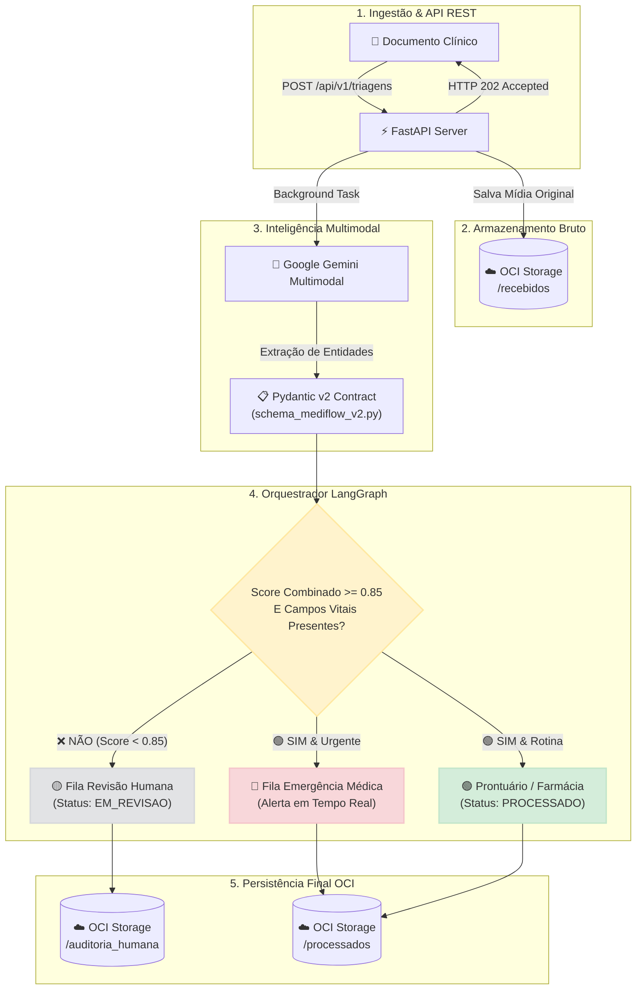

<div align="center">

  <h1> MediFlow: Agente Autônomo para Triagem Clínica</h1>
  <p><b>Triagem, Extração e Roteamento Inteligente de Documentos Médicos com IA Multimodal</b></p>

  <!-- BADGES SHIELDS.IO -->
  <p>
    <a href="#-equipe-15---hackathon-one-g10"></a>
    <a href="#-tecnologias-e-stack"></a>
    <a href="#-tecnologias-e-stack"></a>
    <a href="#-tecnologias-e-stack"></a>
    <a href="#-tecnologias-e-stack"></a>
    <a href="#-tecnologias-e-stack"></a>
    <a href="#-status-do-projeto"></a>
  </p>

  <p>
    <a href="#-visão-geral-do-problema-e-solução">Visão Geral</a> •
    <a href="ARQUITETURA.md"><b>Guia de Arquitetura</b></a> •
    <a href="#-arquitetura-e-fluxo-de-dados">Arquitetura</a> •
    <a href="#-cenários-de-demonstração">Cenários de Teste</a> •
    <a href="#-equipe-15---hackathon-one-g10">Time</a> •
    <a href="#-como-executar">Como Rodar</a>
  </p>

  ---
</div>

> [!NOTE]
> **Hackathon ONE G10 - BRASIL**: O **MediFlow** foi desenvolvido para eliminar gargalos de digitação e triagem manual em hospitais e operadoras de saúde, reduzindo o tempo de atendimento de **15 minutos para menos de 5 segundos** por documento.

---

## 📌 Visão Geral do Problema e Solução

O processamento manual de documentos clínicos representa um gargalo financeiro e operacional crítico no setor de saúde, resultando em:

- ⏳ **Lentidão na triagem de urgências:** Atrasos no encaminhamento de achados críticos (ex.: *Tromboembolismo Pulmonar Agudo*).
- 💸 **Elevado custo administrativo:** Dependência de auditoria manual para validação de guias e autorizações.
- ❌ **Glosas médicas e retrabalho:** Inconsistências causadas por erro de digitação de CRM, dosagens ou identificação do paciente.

O **MediFlow** atua como um **Agente Autônomo Multimodal** que lê documentos clínicos em múltiplos formatos (`PDF`, `PNG`, `JPG`, `TXT`), extrai entidades estruturadas com validação estrita via **Pydantic v2**, calcula scores de confiança combinada e executa o roteamento condicional inteligente via **LangGraph**, persistindo os dados na nuvem **Oracle Cloud Infrastructure (OCI Object Storage)**.

---

## ⚡ Principais Funcionalidades

| Ícone | Funcionalidade | Descrição Técnica |
| :---: | :--- | :--- |
| 🚀 | **Ingestão Assíncrona** | API REST em **FastAPI** respondendo com `HTTP 202 Accepted` + polling (`GET`), evitando *timeouts* durante a inferência. |
| 🛡️ | **Contratos Estritos Pydantic v2** | Separação entre os 5 campos vitais (*Paciente, Idade, Médico, CRM, Diagnóstico*) e campos neutros, garantindo **fidelidade sem alucinações**. |
| 🛑 | **Trava Human-in-the-Loop (HITL)** | Retenção automática em `EM_REVISAO` se o score combinado for `< 0.85`, se houver rasura ou ausência de dado vital. |
| 🚨 | **Gerenciamento de Casos Mistos** | Atribuição dupla e síncrona para casos de urgência com rasura (`FILA_EMERGENCIA_MEDICA` + `FILA_REVISAO_HUMANA`). |
| ☁️ | **Persistência Segura OCI** | Armazenamento automático segregado nas pastas `/recebidos`, `/processados` e `/auditoria_humana` na nuvem Oracle. |

> [!IMPORTANT]
> **Regra do Limiar de Confiança (\\(0.85\\)):** O score de confiança combinado é calculado por \\(\min(\text{score\_classificacao}, \text{score\_extracao})\\). Qualquer documento abaixo de **0.85** é travado para revisão humana.

---

## 🏗️ Arquitetura e Fluxo de Dados

O ciclo de vida do documento no **MediFlow** é totalmente desacoplado e assíncrono:



---

## 🧪 Cenários de Demonstração

Testamos a robustez do **MediFlow** através dos 3 cenários clínicos obrigatórios do edital:

| Cenário | Tipo de Documento | Score Extraído | Destino Atribuído | Status Resultante |
| :--- | :--- | :---: | :--- | :---: |
| **1. Rotina** | RX de Tórax Normal | `0.94` (High) | `PRONTUARIO_ELETRONICO` | <mark>🟢 PROCESSADO</mark> |
| **2. Urgência** | Angiotomografia (TEP Agudo - CID I26.9) | `0.98` (High) | `FILA_URGENCIA_MEDICA` | <mark>🚨 URGENTE (ALERTA)</mark> |
| **3. Ambíguo** | Receita Manuscrita Rasurada | `0.65` (Low) | `FILA_REVISAO_HUMANA` | <mark>🟡 EM_REVISAO</mark> |

---

## 🛠️ Endpoints da API REST

<details>
<summary><b>🔍 Clique aqui para expandir a especificação técnica dos endpoints da API</b></summary>

<br>

### `POST /api/v1/triagens`
* **Descrição:** Envia um arquivo (PDF, Imagem, TXT) para triagem assíncrona.
* **Resposta de Sucesso (`HTTP 202 Accepted`):**
```json
{
  "documento_id": "DOC-8F31A92B",
  "status": "RECEBIDO",
  "mensagem": "Documento recebido e enviado para processamento assíncrono.",
  "timestamp": "2026-10-20T08:00:00Z"
}
```

### `GET /api/v1/triagens/{documento_id}`
* **Descrição:** Consulta o status do processamento e obtém o payload JSON final.
* **Resposta de Sucesso (`HTTP 200 OK`):**
```json
{
  "documento_id": "DOC-8F31A92B",
  "status": "PROCESSADO",
  "classificacao": {
    "categoria": "LAUDO_EXAME_IMAGEM",
    "prioridade": "ROTINA"
  },
  "qualidade": {
    "score_combinado": 0.94,
    "requer_auditoria_humana": false
  },
  "decisao_roteamento": {
    "destinos": ["PRONTUARIO_ELETRONICO"]
  }
}
```

</details>

---

## 📁 Estrutura do Repositório

```text
📂 mediflow/
 ├── 📄 README.md                            # Documentação principal estilizada (v2.0)
 ├── 📜 MediFlow_Especificacao_Funcional_v1.0.pdf # Especificação funcional e requisitos
 ├── 🐍 schema_mediflow_v2.py                # Contrato Pydantic v2 de validação clínica
 ├── 🐍 app_mediflow_fastapi_v2.py           # API REST FastAPI com ingestão assíncrona
 ├── 🐍 cenarios_teste_mediflow_v2.py        # Suíte de testes automatizada (3 cenários)
 ├── 🐍 prompt_clinico_mediflow.py           # System Prompts clínicos para o Gemini
 ├── 🐍 teste_oci_mediflow.py                # Script de validação dos buckets OCI
 └── 📊 mediflow-trello-import.csv           # Matriz de tarefas e planejamento
```

---

## 👥 Equipe 15 - Hackathon ONE G10

<div align="center">

| Integrante | Função / Papel no Projeto | Especialidade & Atuação |
| :--- | :--- | :--- |
| **Luciana Freitag** | 👑 AI Engineer (Líder) | Pydantic Schema, System Prompts & Pitch |
| **Giovane Brandino** | 🤖 AI Agent Engineer | LangGraph, Grafo Condicional & Regras de Score |
| **Iza Paloma M. Coelho** | ☁️ Cloud & Infra Lead | OCI Object Storage, SDK Python & Buckets |
| **Marcelo Petitot Rezende** | ⚙️ Backend Architect | API REST FastAPI Assíncrona & Docker |
| **Cristiano Oliveira** | 🔌 Backend Developer | Endpoints de Ingestão & Notificações |
| **Victor Marcelo** | 🎨 Frontend Developer | React Interface, Figma Wireframes & UX |
| **William** | 🧪 QA & Requirements Lead | Especificação Funcional v1.0 & Suíte de 67 Testes |
| **Gisele Oliveira** | 🧠 AI & Data Support | Suporte em Arquitetura & Suíte de Dados |
| **Alexander Lin** | 🔄 Integration Support | Suporte em APIs, Automações & Pitch Support |

</div>

---

## 💻 Como Executar o Projeto Localmente

### 1️⃣ Clonar o Repositório & Instalar Dependências
```bash
git clone [suspicious link removed]
cd mediflow
pip install fastapi uvicorn pydantic oci google-generativeai httpx
```

### 2️⃣ Executar a Bateria de Testes Automatizada
```bash
python -m pytest
```

### 3️⃣ Subir o Servidor FastAPI
```bash
uvicorn app_mediflow_fastapi_v2:app --reload --port 8000
```
> 🌐 **Swagger UI:** Acesse a documentação interativa das rotas em `http://localhost:8000/docs`

---

> [Atenção]
> **Privacidade e LGPD (RNF-08):** O MediFlow utiliza **exclusivamente massa de dados sintética/fictícia**. NENHUM dado real de paciente ou profissional de saúde é manipulado no repositório.

<div align="center">
  <p><i>Desenvolvido com ❤️ pela <b>Equipe 15</b> no Hackathon ONE G10 - BRASIL</i></p>
</div>


---

## 📜 Licença

Este projeto foi desenvolvido para fins educacionais e de avaliação no âmbito do **Hackathon ONE G10 (Oracle Next Education & Alura)** sob a licença [MIT](LICENSE).
