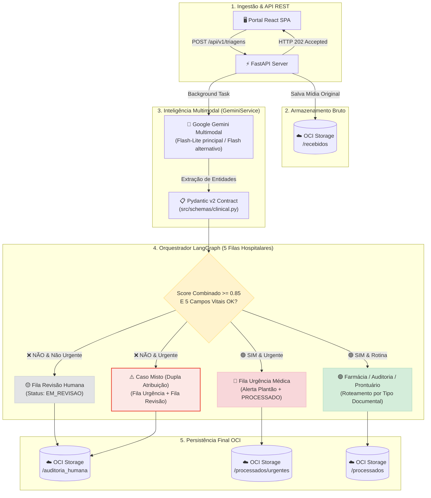

<div align="center">

  <h1> MediFlow: Agente Autônomo para Triagem Clínica</h1>
  <p><b>Triagem, Extração e Roteamento Inteligente de Documentos Médicos com IA Multimodal</b></p>

  <!-- BADGES SHIELDS.IO -->
  <p>
    <a href="#-equipe-15---hackathon-one-g10"></a>
    <a href="#-tecnologias-e-stack"></a>
    <a href="#-tecnologias-e-stack"></a>
    <a href="#-tecnologias-e-stack"></a>
    <a href="#-tecnologias-e-stack"></a>
    <a href="#-tecnologias-e-stack"></a>
    <a href="#testes-automatizados"></a>
    <a href="#-status-do-projeto"></a>
  </p>

  <p>
    <a href="#-visão-geral-do-problema-e-solução">Visão Geral</a> •
    <a href="#-principais-funcionalidades">Funcionalidades</a> •
    <a href="#-arquitetura-e-fluxo-de-dados">Arquitetura</a> •
    <a href="#-cenários-de-demonstração">Cenários de Teste</a> •
    <a href="#-endpoints-da-api-rest">API</a> •
    <a href="#-estrutura-do-repositório">Estrutura</a> •
    <a href="#-equipe-15---hackathon-one-g10">Time</a> •
    <a href="#-como-executar-o-projeto-localmente">Como Rodar</a> •
    <a href="ARQUITETURA.md"><b>Guia de Arquitetura</b></a> •
    <a href="docs/GUIA_INTEGRACAO_API.md"><b>Guia da API (Frontend)</b></a>
  </p>

  ---
</div>

> [!NOTE]
> **Hackathon ONE G10 - BRASIL**: O **MediFlow** foi desenvolvido para apoiar a triagem de documentos clínicos com extração estruturada e roteamento automatizado. O tempo de processamento depende do documento, do modelo de IA e da disponibilidade dos serviços. As medições da versão da entrega serão registradas nas evidências de QA.

---

## 📌 Visão Geral do Problema e Solução

O processamento manual de documentos clínicos representa um gargalo financeiro e operacional crítico no setor de saúde, resultando em:

- ⏳ **Lentidão na triagem de urgências:** Atrasos no encaminhamento de achados críticos (ex.: *Tromboembolismo Pulmonar Agudo*).
- 💸 **Elevado custo administrativo:** Dependência de auditoria manual para validação de guias e autorizações.
- ❌ **Glosas médicas e retrabalho:** Inconsistências causadas por erro de digitação de CRM, dosagens ou identificação do paciente.

O **MediFlow** atua como um **Agente Autônomo Multimodal** que lê documentos clínicos em múltiplos formatos (`PDF`, `PNG`, `JPG`, `TXT`), extrai entidades estruturadas com validação estrita via **Pydantic v2**, calcula scores de confiança combinada e executa o roteamento condicional inteligente via **LangGraph**, persistindo os dados na nuvem **Oracle Cloud Infrastructure (OCI Object Storage)**.

---

## ⚡ Principais Funcionalidades

| Ícone | Funcionalidade | Descrição Técnica |
| :---: | :--- | :--- |
| 🚀 | **Ingestão Blindada & Assíncrona** | Validação estrita de limites de segurança (**10.00MB** e **20 páginas** - Regra A6). Suporte a PDF, TXT e Imagens (JPG, PNG, WEBP), com rejeição imediata de DOCX (HTTP 415) e resposta assíncrona (`HTTP 202 Accepted`). |
| 🛡️ | **Contratos Estritos Pydantic v2** | Separação entre os 5 campos vitais (*Paciente, Idade, Médico, CRM, Diagnóstico*) e campos neutros, garantindo **fidelidade sem alucinações**. |
| 🛑 | **Trava Human-in-the-Loop (HITL)** | Retenção automática em `EM_REVISAO` se o score combinado for `< 0.85`, se houver rasura ou ausência de dado vital. |
| 🚨 | **Gerenciamento de Casos Mistos** | Atribuição dupla e síncrona para casos de urgência com ambiguidade (`FILA_URGENCIA_MEDICA` + `FILA_REVISAO_HUMANA`). |
| ☁️ | **Persistência Segura OCI** | Armazenamento automático segregado nas pastas `/recebidos`, `/processados` e `/auditoria_humana` na nuvem Oracle Always Free. |
| 🖥️ | **Estratégia Dual de Frontend** | **Portal Corporativo em React SPA (Giovane Brandino)** para produção + **Bancada Streamlit (HiTL)** para testes rápidos e auditoria médica. |

> [!IMPORTANT]
> **Regra do Limiar de Confiança (0.85):** O score de confiança combinado é calculado por `min(score_classificacao, score_extracao)`. Qualquer documento com score abaixo de **0.85** é retido compulsoriamente para revisão humana.

---

## 🏗️ Arquitetura e Fluxo de Dados

O ciclo de vida do documento no **MediFlow** é totalmente desacoplado e assíncrono:



O diagrama representa o fluxo da API consumida pelo React. A bancada Streamlit executa a ingestão e o pipeline diretamente no processo Python. O fluxo detalhado está no [Guia de Arquitetura](ARQUITETURA.md).

---

## 🧪 Cenários de Demonstração

Testamos a robustez do **MediFlow** através dos 3 cenários clínicos obrigatórios do edital:

| Cenário | Tipo de Documento | Score Extraído | Destino Atribuído | Status Resultante |
| :--- | :--- | :---: | :--- | :---: |
| **1. Rotina** | RX de Tórax Normal | `0.94` (High) | `PRONTUARIO_ELETRONICO` | <mark>🟢 PROCESSADO</mark> |
| **2. Urgência** | Angiotomografia (TEP Agudo - CID I26.9) | `0.98` (High) | `FILA_URGENCIA_MEDICA` | <mark>🚨 PROCESSADO — prioridade URGENTE, com alerta simulado</mark> |
| **3. Ambíguo** | Receita Manuscrita Rasurada | `0.65` (Low) | `FILA_REVISAO_HUMANA` | <mark>🟡 EM_REVISAO</mark> |

---

## 🛠️ Endpoints da API REST

> [!TIP]
> **Manual de Integração com o Frontend:** Para especificações completas de requisições multipart, polling de status, linha do tempo de auditoria, contratos TypeScript e exemplos práticos com **Fetch nativo** (padrão PR #24), consulte o [**Guia de Integração da API MediFlow para o Frontend**](docs/GUIA_INTEGRACAO_API.md).

<details>
<summary><b>🔍 Clique aqui para expandir a especificação rápida dos endpoints da API</b></summary>

<br>

### `POST /api/v1/triagens`
* **Descrição:** Envia texto clínico em JSON ou arquivo (PDF, imagem ou TXT) em multipart para triagem assíncrona.
* **Resposta de Sucesso (`HTTP 202 Accepted`):**
```json
{
  "documento_id": "DOC-CLIN-2026-8F31A92B",
  "status": "RECEBIDO",
  "status_url": "/api/v1/triagens/DOC-CLIN-2026-8F31A92B/status",
  "historico_url": "/api/v1/triagens/DOC-CLIN-2026-8F31A92B/historico",
  "mensagem": "Documento textual aceito e enfileirado para processamento."
}
```

### `GET /api/v1/triagens/{documento_id}`
* **Descrição:** Retorna o resultado completo da triagem. Consulte esta rota após `GET /api/v1/triagens/{documento_id}/status` informar `concluido: true`.
* **Exemplo resumido da resposta (`HTTP 200 OK`):**

```json
{
  "documento_id": "DOC-CLIN-2026-8F31A92B",
  "status": "PROCESSADO",
  "classificacao": {
    "tipo_documento": "LAUDO_EXAME_IMAGEM",
    "nivel_prioridade": "ROTINA"
  },
  "qualidade": {
    "score_combinado": 0.94,
    "limiar_aplicado": 0.85
  },
  "decisao_roteamento": {
    "destino_principal": "PRONTUARIO_ELETRONICO",
    "destinos": ["PRONTUARIO_ELETRONICO"],
    "requer_auditoria_humana": false
  }
}
```

A resposta completa segue o contrato `TriagemMediFlow`. O campo `status` informa o resultado funcional, inclusive estados de erro retornados com HTTP `200`. Consulte o [Guia de Integração da API](docs/GUIA_INTEGRACAO_API.md) para o contrato completo.

</details>

---

## 📁 Estrutura do Repositório

```text
g10-brasil-equipe-15_mediflow/
├── data/                                       # Amostras clínicas dos 3 cenários do edital (PDF/JSON)
├── docs/                                       # Governança de testes, contratos de dados e guias
│   ├── GUIA_INTEGRACAO_API.md                  # Guia de integração da API REST para o Frontend React / Streamlit
│   └── testes/                                 # Contrato Canônico, Catálogo dos 79 Fixtures e Auditorias
├── src/                                        # Código-fonte da aplicação (Python Backend & IA)
│   ├── agents/                                 # Agentes e Prompts de Inteligência Multimodal
│   ├── api/                                    # API REST FastAPI Assíncrona (/api/v1/triagens)
│   ├── app/                                    # Bancada Streamlit de testes rápidos e auditoria médica (HiTL)
│   ├── ingestion/                              # Ingestão blindada (10MB, 20 págs, sanitização de PDF/TXT/Imagens)
│   ├── schemas/                                # Contrato Canônico Pydantic v2 (clinical.py)
│   ├── services/                               # Serviços de Integração (GeminiService com REST e timeout 30s)
│   │   └── gemini_service.py                   # Integração Gemini com Flash-Lite principal, Flash alternativo e fallback local
│   ├── storage/                                # Conector OCI Object Storage Always Free (oci_storage.py)
│   ├── workflow/                               # Grafo de Decisão Clínica LangGraph (StateGraph)
│   └── config.py                               # Configurações globais e variáveis de ambiente
├── scripts/                                    # Utilitários de homologação e scripts de diagnóstico
│   ├── testar_simulacao_oci.py                 # Validação da simulação de falhas OCI do catálogo EPT v1.0 (§12)
│   └── testar_oci.py                           # Validação real ponta a ponta no bucket OCI Always Free
├── tests/                                      # Testes automatizados com Pytest
│   ├── fixtures/                               # 79 fixtures canônicos (demo, catalogo, manifest.csv)
│   ├── test_workflow.py                        # Roteamento e arestas LangGraph
│   ├── test_contrato_fixtures.py               # Contratos das fixtures e regras R1 a R8
│   ├── test_api.py                            # Endpoints REST FastAPI e EPT
│   ├── test_extraction_adapter.py             # Adaptação de envelopes de extração
│   ├── test_ingestion.py                      # Formatos, limites e rejeições de arquivos
│   ├── test_gemini_service.py                 # GeminiService, transporte REST, timeout e fallback
│   ├── test_gemini_workflow_adapter.py        # Integração entre GeminiService e workflow
│   ├── test_audit_items.py                    # Auditoria técnica e sanidade
│   ├── test_oci_storage.py                    # Persistência OCI com SDK simulado
│   ├── test_schemas.py                        # Validação Pydantic v2
│   ├── test_streamlit_pipeline.py             # Pipeline Streamlit e preservação de sinais
│   ├── test_gemini_prioridades_dosagem.py      # Prioridades e dosagens na extração
│   ├── test_exemplos_extracao_workflow.py      # Exemplos de extração no workflow
│   └── test_pr13_persistencia_pendente.py     # Persistência pendente e retentativa OCI
├── testar_gemini.py                            # Script de validação manual da IA com Google Gemini
├── frontend/                                   # (Recomendado) Portal Web Corporativo (React SPA - Giovane Brandino)
├── ARQUITETURA.md                              # Especificação Técnica Oficial da Arquitetura
├── README.md                                   # Documentação Principal do Repositório
├── pytest.ini                                  # Configuração corporativa do Pytest
└── requirements.txt                            # Dependências oficiais do ecossistema Python
```
> 🔍 *Para visualizar a hierarquia detalhada com subdiretórios e a arquitetura completa do frontend React, consulte o [**Guia de Arquitetura (ARQUITETURA.md)**](ARQUITETURA.md#📁-9-estrutura-de-diretórios--organização-do-repositório).*

---

## 👥 Equipe 15 - Hackathon ONE G10

<div align="center">

| Integrante | Função / Papel no Projeto | Especialidade & Atuação |
| :--- | :--- | :--- |
| **Luciana Freitag** | 👑 Líder do projeto e de Engenharia de IA | GeminiService multimodal, schemas Pydantic, prompts, fallbacks e testes de extração. |
| **Giovane Brandino** | 🎨 Líder e desenvolvedor de frontend | Portal React, telas de envio, acompanhamento, filas e resultado, modo demo e integração com a API. |
| **Iza Paloma M. Coelho** | ☁️ Líder de Agentes de IA e Nuvem | Grafo de decisão em LangGraph, adaptação da extração do Gemini ao workflow, conector OCI, persistência e recuperação do histórico, testes no bucket real e segregação dos resultados por status. |
| **Cristiano Oliveira** | ⚙️ Arquiteto e desenvolvedor de backend | Arquitetura, API REST assíncrona em FastAPI, ingestão, integração do Gemini e do LangGraph à API, tratamento de falhas e retentativas de persistência. |
| **William** | 🧪 Líder de QA e Requisitos | Especificação Funcional v1.2, análise de requisitos, plano de testes, fixtures e critérios de validação. |

</div>

---

## 💻 Como Executar o Projeto Localmente

### 1️⃣ Clonar o Repositório & Instalar Dependências
```bash
git clone https://github.com/No-Country-simulation/g10-brasil-equipe-15_mediflow.git
cd g10-brasil-equipe-15_mediflow

# Crie e ative seu ambiente virtual Python
python -m venv .venv
.venv\Scripts\activate   # No Windows (ou source .venv/bin/activate no Linux/Mac)

# Instale as dependências oficiais
pip install -r requirements.txt
cp .env.example .env
```

> ⚙️ **Variáveis de Ambiente Essenciais (`.env`):**
> - `GEMINI_API_KEY`: Chave da API do Google AI Studio para o extrator multimodal.
> - `LIMIAR_CONFIANCA`: Ponto de corte do score de confiança combinado (padrão `0.85`). Documentos com score abaixo desse valor são retidos compulsoriamente em `EM_REVISAO` (`FILA_REVISAO_HUMANA`), e o valor aplicado é retornado pela API em `qualidade.limiar_aplicado`.
> - `FIXTURE_MODE`: `true` faz as fixtures oficiais de fronteira (ex.: `Borda_Score_084`) usarem o score de `modo_fixture.score_forcado` no lugar do calculado, para demonstrar a revisão humana. Padrão `false`; ligar só em ambiente de demonstração.
> - Credenciais OCI (opcionais em modo demo/simulação local).

<a id="testes-automatizados"></a>
### 2️⃣ Executar os testes automatizados
```bash
python -m pytest
```

### 3️⃣ Testes Manuais Opcionais (Cloud OCI e IA Gemini)
```bash
# Validar conexão ao bucket OCI Always Free
python -m scripts.testar_oci

# Validar integração e fallback do Google Gemini
python testar_gemini.py
```

### 4️⃣ Iniciar as Aplicações

- **Opção A: Bancada de Testes & Auditoria Streamlit (HiTL)**
```bash
streamlit run src/app/streamlit_app.py
```

- **Opção B: Servidor FastAPI (Backend REST para React e HIS)**
```bash
uvicorn src.api.main:app --reload --port 8000
```
> 🌐 **Swagger UI:** Acesse a documentação interativa das rotas em `http://localhost:8000/docs`

---

> [!NOTE]
> **Delimitação de Escopo do MVP:** A fila de trabalho e o histórico em execução no servidor FastAPI operam em memória RAM durante a vida do processo (sem continuidade entre reinícios), enquanto os documentos originais e resultados JSON são persistidos no OCI Object Storage. O sistema não utiliza motor OCR local offline (como Tesseract): PDFs digitais usam PyMuPDF e imagens/digitalizados dependem da análise multimodal via `GeminiService`.

> [!WARNING]
> **Privacidade e LGPD (RNF-08):** O MediFlow utiliza **exclusivamente massa de dados sintética/fictícia**. NENHUM dado real de paciente ou profissional de saúde é manipulado no repositório.

<div align="center">
  <p><i>Desenvolvido com ❤️ pela <b>Equipe 15</b> no Hackathon ONE G10 - BRASIL</i></p>
</div>


---

## 📜 Licença

Este projeto foi desenvolvido para fins educacionais e de avaliação no âmbito do **Hackathon ONE G10 (Oracle Next Education & Alura)** sob a licença [MIT](LICENSE).
