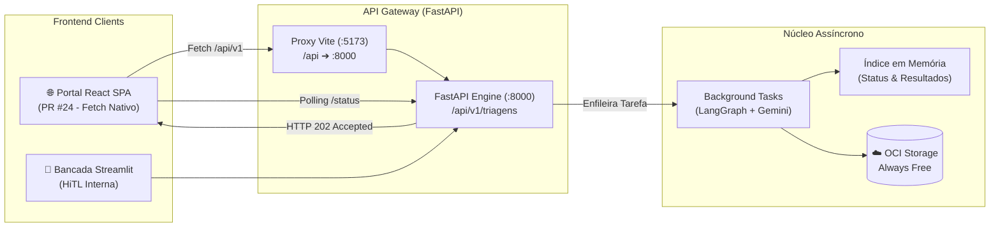
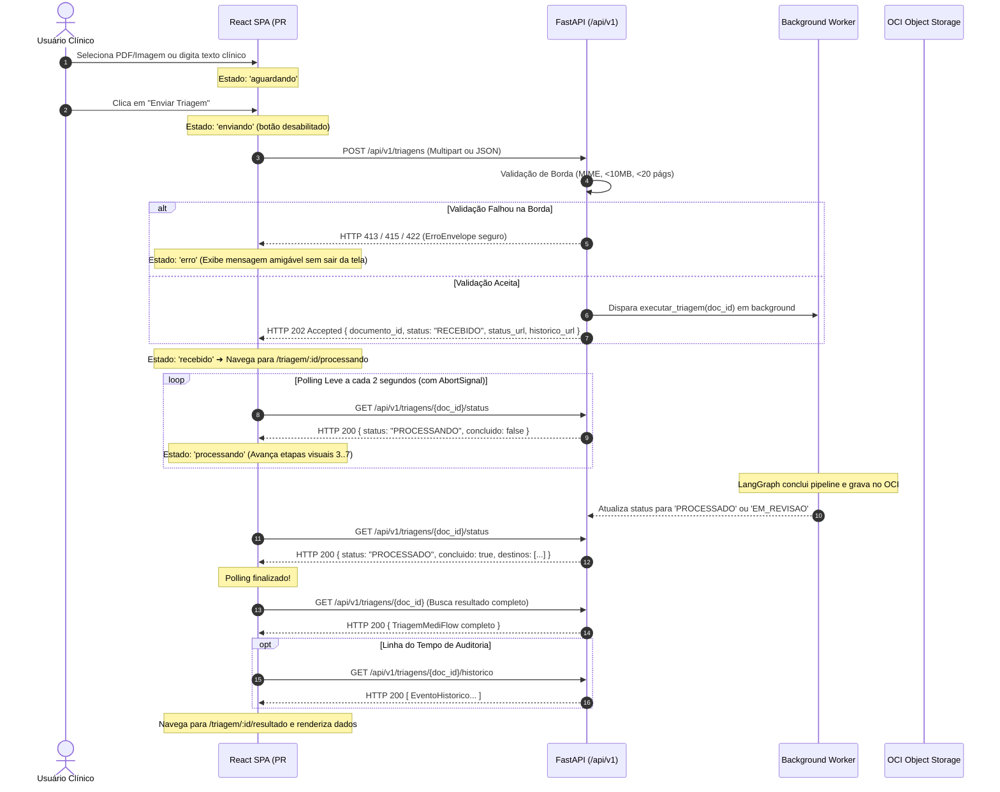

# 📖 Guia de Integração da API MediFlow para o Frontend

> **Hackathon ONE G10 — Oracle Next Education & Alura**  
> **Equipe 15:** MediFlow — Agente Autônomo para Triagem Clínica  
> **Público-alvo:** Desenvolvedores do Portal Web React SPA (PR #24) e da Bancada Streamlit HiTL  
> **Base de Referência:** Especificação Funcional v1.2 (§10, §11, §12 e §13), Análise de Requisitos v1.2 e Contrato de Dados v1.0

---

## 1. Visão Geral e Arquitetura de Comunicação

O **MediFlow** adota uma **Estratégia Dual de Frontend**:
1. **Portal Corporativo React SPA** (desenvolvido por Giovane Brandino na branch `feature/frontend-react-base` / PR #24), construído com Vite, React, TypeScript, Tailwind CSS e consumo via **Fetch nativo** encapsulado em `frontend/src/services/api.ts`.
2. **Bancada Streamlit HiTL** (`src/app/streamlit_app.py`) para demonstrações rápidas de laboratório e auditoria médica.

O backend expõe uma **API REST FastAPI assíncrona** sob o prefixo `/api/v1`, projetada para desonerar o cliente imediatamente (`HTTP 202 Accepted`) e delegar o processamento cognitivo (Gemini Multimodal + LangGraph + OCI Object Storage) a tarefas em segundo plano.



### URLs e Documentação Interativa
* **Base URL do Servidor Local:** `http://localhost:8000/api/v1`
* **Swagger UI (OpenAPI interativo):** [`http://localhost:8000/docs`](http://localhost:8000/docs)
* **ReDoc (Documentação técnica formal):** [`http://localhost:8000/redoc`](http://localhost:8000/redoc)
* **Especificação OpenAPI bruta:** [`http://localhost:8000/openapi.json`](http://localhost:8000/openapi.json)

### Como Iniciar a API Localmente
No diretório raiz do projeto, com o ambiente virtual ativado:
```powershell
# Ativação do ambiente virtual
.venv\Scripts\Activate.ps1

# Inicialização do servidor FastAPI
uvicorn src.api.main:app --reload --port 8000
```

### Chaveamento: Modo Demo (Fixtures) vs. Backend Real
No Portal React SPA (`frontend/`), o arquivo `.env` controla o destino das requisições:
```bash
# Para consumir a API FastAPI local real via proxy Vite:
VITE_API_URL=
VITE_USAR_FIXTURES=false

# Para rodar 100% isolado no navegador com mock dos 3 cenários clínicos do edital:
VITE_USAR_FIXTURES=true
```

---

## 2. Ciclo de Vida da Triagem & Fronteira de Estados

### Mapeamento: Estados de Interface (UX) vs. Estados da API (Backend)
Conforme a **Especificação Funcional v1.2 (§11, item 3)**, a interface deve apresentar os estados do ciclo de vida do documento. A tabela abaixo demarca com precisão a responsabilidade de cada camada:

| Estado de Tela (EF v1.2 §11) | Responsável Principal | Origem do Estado | Papel da API REST | Comportamento no Frontend React |
| :--- | :--- | :--- | :--- | :--- |
| **`aguardando`** | **Frontend** | Local (`fase: 'ocioso'`) | Inativo (nenhuma chamada feita). | Formulário em `NovaTriagemPage` pronto para seleção de arquivo ou digitação de texto. |
| **`enviando`** | **Frontend** | Local (`fase: 'enviando'`) | Recebendo stream multipart ou corpo JSON. | Botão "Enviar Triagem" desabilitado para impedir duplo clique; exibe indicador de upload. |
| **`recebido`** | **API ➔ Frontend** | Backend (`HTTP 202`) | Retorna `HTTP 202 Accepted` (`status: "RECEBIDO"`). | Redireciona para `/triagem/:id/processando`. Primeira etapa da régua visual é concluída. |
| **`processando`** | **API ➔ Frontend** | Backend (`GET .../status`) | Responde `status: "PROCESSANDO"` no polling. | Polling a cada 2s. Animação progressiva das etapas 3 a 7 a cada ~4s (`etapasProcessamento.ts`). |
| **`processado`** | **API ➔ Frontend** | Backend (Terminal) | Responde `concluido: true` e `status: "PROCESSADO"`. | Redireciona para `/triagem/:id/resultado`. Exibe dados clínicos e destinos de rotina. |
| **`em_revisão`** | **API ➔ Frontend** | Backend (Terminal) | Responde `concluido: true` e `status: "EM_REVISAO"`. | Redireciona para tela de resultado destacando retenção para auditoria humana (score < 0.85 ou conflitos). |
| **`erro`** | **API ➔ Frontend** | Backend (Borda/Terminal) | Retorna envelope seguro de erro (`ErroEnvelope`). | Se na borda (4xx): exibe toast/alerta no envio. Se no processamento (5xx): exibe tela de falha com opção de retry. |

### Diagrama de Sequência do Fluxo Assíncrono (Decisão 6 da EF v1.2)



> [!IMPORTANT]
> **Regra de Ouro da EF v1.2:** O frontend deve chamar `GET /api/v1/triagens/{documento_id}` **apenas após** `GET /api/v1/triagens/{documento_id}/status` retornar `concluido: true`. Se a rota do payload completo for chamada antes do término, a API executará o pipeline de forma síncrona para não deixar o cliente sem resposta, o que bloqueia o processo.

---

## 3. Catálogo Detalhado de Endpoints

### 3.1 Submeter Triagem Clínica
* **Rota:** `POST /api/v1/triagens`
* **Status de Sucesso:** `HTTP 202 Accepted`
* **Descrição:** Recebe um documento clínico para triagem assíncrona. Aceita tanto arquivos físicos quanto texto clínico puro.

#### Modo A: Envio de Arquivo (`multipart/form-data`)
Utilizado para upload de laudos, receitas e guias em PDF ou imagens.
* **Headers:** `Content-Type: multipart/form-data`
* **Campos do Form:**
  * `file` *(obrigatório, File)*: Arquivo binário nos formatos suportados (`.pdf`, `.png`, `.jpg`, `.jpeg`, `.webp`, `.txt`). Limite: **10.00 MB** e até **20 páginas**.
  * `documento_id` *(opcional, string)*: Identificador externo customizado. Se omitido, a API gera automaticamente no formato `DOC-{HEX_8}` (ex: `DOC-A1B2C3D4`).
  * `canal_origem` *(opcional, string)*: Canal de entrada. Padrão: `"Upload"`.

#### Modo B: Envio de Texto Clínico (`application/json`)
Utilizado quando o texto já foi digitado ou copiado no prontuário.
* **Headers:** `Content-Type: application/json`
* **Corpo da Requisição (JSON):**
```json
{
  "documento_texto": "Paciente Maria de Souza, 68 anos. Prescrevo Clexane 40mg SC 1x ao dia. Dra. Camila CRM 123456/SP.",
  "documento_id": "DOC-CUSTOM-001",
  "tipo_arquivo": "TEXTO",
  "canal_origem": "Prontuário",
  "metadados": {
    "setor": "Emergência"
  }
}
```

#### Resposta de Sucesso (`HTTP 202 Accepted`):
```json
{
  "documento_id": "DOC-A1B2C3D4",
  "status": "RECEBIDO",
  "status_url": "/api/v1/triagens/DOC-A1B2C3D4/status",
  "historico_url": "/api/v1/triagens/DOC-A1B2C3D4/historico",
  "mensagem": "Documento aceito e enfileirado para processamento."
}
```

---

### 3.2 Polling Leve de Status
* **Rota:** `GET /api/v1/triagens/{documento_id}/status`
* **Status de Sucesso:** `HTTP 200 OK`
* **Descrição:** Endpoint otimizado e de baixo custo para acompanhamento na tela de progresso. Retorna se a triagem já terminou e quais os destinos preliminares.

#### Resposta durante o processamento (`HTTP 200 OK`):
```json
{
  "documento_id": "DOC-A1B2C3D4",
  "status": "PROCESSANDO",
  "destinos": [],
  "requer_auditoria_humana": false,
  "concluido": false
}
```

#### Resposta após a conclusão (`HTTP 200 OK`):
```json
{
  "documento_id": "DOC-A1B2C3D4",
  "status": "PROCESSADO",
  "destinos": [
    "Fila de Urgência Médica (Alerta Plantão)",
    "Prontuário Eletrônico do Paciente (PEP)"
  ],
  "requer_auditoria_humana": false,
  "concluido": true
}
```

---

### 3.3 Obter Resultado Completo da Triagem
* **Rota:** `GET /api/v1/triagens/{documento_id}`
* **Status de Sucesso:** `HTTP 200 OK`
* **Descrição:** Retorna o payload canônico completo `TriagemMediFlow`, contendo dados extraídos, classificação clínica, scores de confiança combinada, destinos hospitalares e referências de persistência no OCI.

#### Exemplo de Resposta Estruturada (`HTTP 200 OK`):
```json
{
  "documento_id": "DOC-A1B2C3D4",
  "status": "PROCESSADO",
  "classificacao": {
    "tipo_documento": "Receituário Médico",
    "especialidade": "Cardiologia",
    "prioridade": "URGENTE",
    "confianca": 0.98,
    "justificativa": "Prescrição com indicação de anticoagulação imediata por suspeita de TEP."
  },
  "dados_extraidos": {
    "paciente": {
      "nome": "Maria de Souza",
      "idade": 68
    },
    "medico": {
      "nome": "Camila Guimarães",
      "crm": "123456/SP",
      "uf": "SP"
    },
    "diagnostico": {
      "texto": "Suspeita de Tromboembolismo Pulmonar Agudo",
      "cid10": "I26"
    },
    "medicamentos": [
      {
        "nome": "Enoxaparina Sódica (Clexane)",
        "dosagem": "40mg",
        "via": "Subcutânea",
        "posologia": "1x ao dia"
      }
    ],
    "exames": [],
    "dados_ausentes": [],
    "dados_incertos": []
  },
  "qualidade": {
    "score_classificacao": 0.98,
    "score_extracao": 0.95,
    "score_combinado": 0.95,
    "requer_auditoria_humana": false,
    "conflitos": []
  },
  "decisao_roteamento": {
    "destinos": [
      "Fila de Urgência Médica (Alerta Plantão)",
      "Farmácia Hospitalar / Dispensação de Medicamentos"
    ],
    "justificativa": "Caso urgente com score 0.95 superior ao limiar 0.85 e sem conflitos impeditivos.",
    "requer_auditoria_humana": false
  },
  "notificacao": {
    "disparar_alerta": true,
    "mensagem": "🚨 ALERTA: Paciente Maria de Souza triada para Fila de Urgência Médica.",
    "destinatario": "Plantão Médico / UTI",
    "canal": "PAINEL_HOSPITALAR"
  },
  "armazenamento_oci": {
    "bucket": "mediflow-bucket",
    "caminho_objeto": "processados/2026/11/DOC-A1B2C3D4/resultado.json",
    "versao_objeto": "v1.2",
    "status_persistencia": "CONFIRMADO"
  }
}
```

---

### 3.4 Histórico e Linha do Tempo de Auditoria (CT-070 a CT-072)
* **Rota:** `GET /api/v1/triagens/{documento_id}/historico`
* **Status de Sucesso:** `HTTP 200 OK`
* **Descrição:** Retorna a linha do tempo cronológica com eventos de auditoria imutáveis (conforme Decisão D-02 da EF v1.2: recebimento, processamento, conclusão/erro e eventuais reprocessamentos).

#### Exemplo de Resposta (`HTTP 200 OK`):
```json
[
  {
    "evento_id": "EVT-89A12B34",
    "documento_id": "DOC-A1B2C3D4",
    "tipo_evento": "RECEBIMENTO",
    "criado_em": "2026-11-14T14:30:00Z",
    "ator": "API_GATEWAY",
    "status_anterior": null,
    "status_novo": "RECEBIDO",
    "motivo": "Documento aceito e enfileirado para processamento.",
    "versao_esquema": "2.0.0"
  },
  {
    "evento_id": "EVT-90B23C45",
    "documento_id": "DOC-A1B2C3D4",
    "tipo_evento": "PROCESSAMENTO",
    "criado_em": "2026-11-14T14:30:02Z",
    "ator": "LANGGRAPH_WORKFLOW",
    "status_anterior": "RECEBIDO",
    "status_novo": "PROCESSANDO",
    "motivo": "Iniciando pipeline de extração multimodal e roteamento.",
    "versao_esquema": "2.0.0"
  },
  {
    "evento_id": "EVT-91C34D56",
    "documento_id": "DOC-A1B2C3D4",
    "tipo_evento": "CONCLUSAO",
    "criado_em": "2026-11-14T14:30:05Z",
    "ator": "LANGGRAPH_WORKFLOW",
    "status_anterior": "PROCESSANDO",
    "status_novo": "PROCESSADO",
    "motivo": "Triagem concluída com score combinado 0.95.",
    "versao_esquema": "2.0.0"
  }
]
```

---

### 3.5 Reprocessar Persistência OCI (RF-28 e RF-30)
* **Rota:** `POST /api/v1/triagens/{documento_id}/reprocessar-persistencia`
* **Status de Sucesso:** `HTTP 200 OK`
* **Descrição:** Quando uma triagem atinge o estado `ERRO_PERSISTENCIA` (ex.: instabilidade temporária na rede ou credencial expirada do OCI), este endpoint reenvia os artefatos ao bucket **sem reexecutar o fluxo cognitivo nem gastar novos tokens do Gemini**.
* **Retorno:** O payload `TriagemMediFlow` atualizado com status `"PROCESSADO"` ou `"EM_REVISAO"`.

---

### 3.6 Health Check Operacional (CT-076)
* **Rota:** `GET /api/v1/health`
* **Status de Sucesso:** `HTTP 200 OK`
* **Descrição:** Verificação técnica de disponibilidade operacional do servidor sem expor segredos ou dados clínicos.

#### Exemplo de Resposta (`HTTP 200 OK`):
```json
{
  "status": "healthy",
  "versao": "2.0.0",
  "servicos": {
    "api": "ok",
    "langgraph": "ok",
    "oci_storage": "ok"
  }
}
```

---

## 4. Tratamento de Erros e Envelopes Seguros (EF v1.2 §10.1 & §12)

Todas as falhas devolvidas pela API seguem rigorosamente o **Envelope Padronizado de Erro Seguro**, garantindo que nenhum stack trace, prompt interno ou credencial OCI vaze para o cliente (CT-077, CT-080).

### Formato do Envelope Seguro (`ErroEnvelope`):
```json
{
  "codigo": "FORMATO_NAO_SUPORTADO",
  "mensagem": "Formatos aceitos: PDF, JPG, PNG, WEBP e TXT.",
  "detalhes": null
}
```

### Tabela de Códigos HTTP e Tratamento Recomendado na UI

| HTTP Status | Código Funcional (`codigo`) | Causa / Cenário | Rejeição na Borda? | Ação Recomendada no Frontend React |
| :---: | :--- | :--- | :---: | :--- |
| **`400`** | `REQUISICAO_INVALIDA` | JSON malformado ou parâmetros incompatíveis. | Sim | Notificar erro de sintaxe no envio. |
| **`404`** | `DOCUMENTO_NAO_ENCONTRADO` | ID de documento inexistente ou expirado em memória. | Sim | Redirecionar para lista de triagens com banner de "Documento não encontrado". |
| **`409`** | `DOCUMENTO_ID_CONFLITANTE` | Tentativa de submissão com `documento_id` já existente. | Sim | Sugerir ao usuário limpar o campo de ID ou gerar um novo identificador. |
| **`413`** | `ARQUIVO_MAIOR_QUE_LIMITE` | Arquivo excede o teto de **10.00 MB** (Regra A6). | Sim | Bloquear no Dropzone antes do envio ou exibir alerta para comprimir o documento. |
| **`415`** | `FORMATO_NAO_SUPORTADO` | Extensão não suportada (ex: `.docx`, `.zip`). | Sim | Destacar extensões aceitas: PDF, JPG, PNG, WEBP, TXT. |
| **`415`** | `MIME_INVALIDO` | Extensão mente sobre o conteúdo (ex: EXE renomeado para PDF). | Sim | Exibir alerta de arquivo adulterado ou inválido. |
| **`422`** | `CAMPOS_INVALIDOS` | Requisição sem arquivo nem texto, ou corpo JSON vazio. | Sim | Realçar os campos obrigatórios no formulário. |
| **`422`** | `PDF_CORROMPIDO` | Arquivo PDF corrompido, truncado ou com cabeçalho quebrado. | Sim | Solicitar ao usuário novo upload de PDF legível. |
| **`422`** | `PDF_PROTEGIDO` | PDF protegido por senha ou criptografia. | Sim | Orientar o usuário a remover a senha antes de enviar. |
| **`500`** | `ERRO_INTERNO` | Falha não tratada no backend (oculta stack trace). | Não | Exibir mensagem segura: "Ocorreu um erro interno. Tente novamente mais tarde." |
| **`502`** | `ERRO_PERSISTENCIA` | Falha ao gravar no bucket OCI após processamento cognitivo. | Não | Exibir botão de ação: **"Tentar novamente o salvamento no OCI"** (`reprocessarPersistencia`). |

> [!NOTE]
> **Rejeição na Borda vs. Erro de Processamento:**  
> Os erros com status `413`, `415` e `422` ocorrem na validação inicial antes de chamar o modelo Gemini. Eles **não geram `documento_id`**, não consomem tokens e não geram registro no histórico. Já falhas após o aceite são marcadas no status da triagem como `ERRO_PROCESSAMENTO` ou `ERRO_PERSISTENCIA`.

---

## 5. Guia Prático de Consumo no Frontend (Padrão PR #24 - Fetch Nativo)

O Portal React SPA (`frontend/`) centraliza todas as chamadas no wrapper [`frontend/src/services/api.ts`](file:///d:/Cursos/ONE/MediFlow/Projeto%20Principal/g10-brasil-equipe-15_mediflow/frontend/src/services/api.ts) utilizando **Fetch nativo** e tipagens estritas.

### 5.1 O Cliente Base e a Classe `ApiError`
O wrapper converte respostas `!response.ok` em instâncias da classe `ApiError`:

```typescript
// frontend/src/services/erros.ts
export class ApiError extends Error {
  constructor(
    public readonly status: number,
    public readonly codigo: string,
    mensagem: string,
    public readonly detalhes?: unknown,
  ) {
    super(mensagem)
    this.name = 'ApiError'
  }
}
```

### 5.2 Exemplo: Envio de Arquivo (`submeterTriagemArquivo`)
```typescript
import { submeterTriagemArquivo } from '../services/api'

async function handleUpload(arquivo: File) {
  try {
    const resposta = await submeterTriagemArquivo({
      file: arquivo,
      canal_origem: 'Upload Portal Médico',
    })
    console.log('ID gerado:', resposta.documento_id)
    // Redireciona para acompanhamento:
    navigate(`/triagem/${resposta.documento_id}/processando`)
  } catch (erro) {
    if (erro instanceof ApiError) {
      alert(`[${erro.codigo}] ${erro.message}`)
    }
  }
}
```

### 5.3 Exemplo: Polling Resiliente com `AbortSignal` no React
Na página de acompanhamento (`ProcessamentoPage.tsx`), o polling consulta o status a cada 2 segundos e cancela a requisição caso o componente seja desmontado:

```typescript
import { useEffect, useRef, useState } from 'react'
import { obterStatus, obterTriagem } from '../services/api'
import type { StatusTriagemResponse, TriagemMediFlow } from '../types'

export function useAcompanharTriagem(documentoId: string) {
  const [status, setStatus] = useState<StatusTriagemResponse | null>(null)
  const [resultado, setResultado] = useState<TriagemMediFlow | null>(null)
  const [erro, setErro] = useState<string | null>(null)

  useEffect(() => {
    const controller = new AbortController()
    let timer: NodeJS.Timeout

    async function verificar() {
      try {
        const dadosStatus = await obterStatus(documentoId, controller.signal)
        setStatus(dadosStatus)

        if (dadosStatus.concluido) {
          // Status terminal atingido: busca payload completo!
          const dadosResultado = await obterTriagem(documentoId, controller.signal)
          setResultado(dadosResultado)
        } else {
          // Continua polling a cada 2000ms
          timer = setTimeout(verificar, 2000)
        }
      } catch (e: any) {
        if (e.name !== 'AbortError') {
          setErro(e.message || 'Erro ao acompanhar processamento.')
        }
      }
    }

    verificar()

    return () => {
      controller.abort()
      clearTimeout(timer)
    }
  }, [documentoId])

  return { status, resultado, erro }
}
```

---

## 6. DTOs e Tipagens TypeScript de Referência

Para referência rápida dos desenvolvedores, as interfaces espelham os contratos de `src/api/schemas.py` e `src/schemas/clinical.py`:

```typescript
// frontend/src/types/api.ts

export type StatusTriagem =
  | 'RECEBIDO'
  | 'PROCESSANDO'
  | 'PROCESSADO'
  | 'EM_REVISAO'
  | 'ERRO_PROCESSAMENTO'
  | 'ERRO_PERSISTENCIA'

export interface TriagemCriadaResponse {
  documento_id: string
  status: string
  status_url: string
  historico_url: string
  mensagem: string
}

export interface StatusTriagemResponse {
  documento_id: string
  status: StatusTriagem
  destinos: string[]
  requer_auditoria_humana: boolean
  concluido: boolean
}

export interface EventoHistorico {
  evento_id: string
  documento_id: string
  tipo_evento: string
  criado_em: string
  ator: string
  status_anterior?: string | null
  status_novo: string
  motivo?: string | null
  versao_esquema: string
}

export interface ErroEnvelope {
  codigo: string
  mensagem: string
  detalhes?: unknown
}
```

---

## 7. Diretrizes de Apresentação Clínica na UI (EF v1.2 §11)

Ao construir ou evoluir telas no frontend, observe as seguintes diretrizes funcionais:

1. **Acessibilidade em Casos Urgentes:** Casos com `prioridade: "URGENTE"` ou encaminhados para a `Fila de Urgência Médica` devem possuir destaque textual claro (ex.: `[URGENTE]` ou badge vermelho) e ícone visual (`alert.svg`), **nunca dependendo apenas da cor vermelha** para identificação.
2. **Campos Vitais Ausentes:** Se um dado vital (*Paciente, Idade, Médico, CRM ou Diagnóstico*) não estiver presente no documento, ele deve ser explicitamente rotulado na UI como **"Não identificado no documento"**, evitando omitir o campo ou exibir valores nulos genéricos.
3. **Transparência na Simulação:** O rodapé ou banner da interface deve deixar claro que, no escopo deste MVP, o disparo de notificações externas e a integração com sistemas de destino são **simulados** com sucesso durável no OCI Object Storage.
4. **Resiliência a Falhas do OCI:** Se o status final for `ERRO_PERSISTENCIA`, ofereça ao usuário na interface o botão **"Tentar novamente o salvamento no OCI"**, invocando `POST /api/v1/triagens/{id}/reprocessar-persistencia`.
