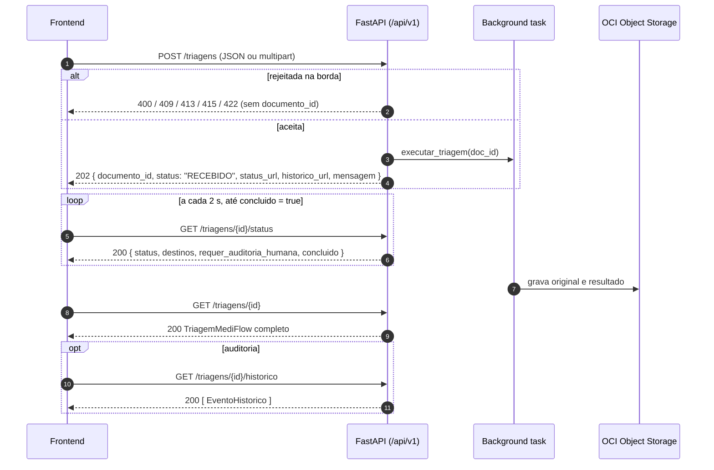

# 📖 Guia de Integração da API MediFlow para o Frontend

> **Hackathon ONE G10 — Oracle Next Education & Alura**
> **Equipe 15:** MediFlow — Agente Autônomo para Triagem Clínica
> **Público-alvo:** desenvolvedores do Portal Web React SPA (PR #24) e da Bancada Streamlit (diferencial)
> **Base de referência:** Especificação Funcional v1.2 (§10 a §13), Análise de Requisitos v1.2, Contrato de Dados

> [!IMPORTANT]
> **Como esta versão foi produzida.** O guia anterior continha erros graves de schema e descrevia uma API idealizada. Esta versão foi auditada e reescrita a partir do código-fonte real: `src/api/routes.py`, `src/api/schemas.py`, `src/schemas/clinical.py`, `src/api/service.py`, `src/api/main.py`, `src/ingestion/loader.py`, `frontend/src/services/api.ts` e `docs/testes/CONTRATO_DE_DADOS.md`.
>
> - Os formatos de resposta abaixo seguem rigorosamente os modelos Pydantic e as rotas FastAPI em execução.
> - **[Divergência]** marca onde o código difere da EF v1.2 ou do Contrato. Todas estão detalhadas no **Apêndice A**.
> - Todos os pontos técnicos anteriormente pendentes de verificação foram auditados contra o backend e frontend reais (ver **Apêndice B**).

---

## 1. Visão Geral

O backend expõe uma **API REST FastAPI assíncrona** sob o prefixo `/api/v1`. A submissão devolve `HTTP 202 Accepted` imediatamente e o processamento (Gemini + LangGraph + OCI Object Storage) roda em segundo plano (`BackgroundTasks`). O cliente acompanha o andamento por polling.

```
React SPA / Streamlit ──POST /api/v1/triagens──▶ FastAPI ──202──▶ cliente
                                                    │
                                                    └─ background: executar_triagem(doc_id)
cliente ──GET .../status (polling)──▶ FastAPI
cliente ──GET .../{id} (só após concluido=true)──▶ resultado completo
```

### URLs

- **Base local:** `http://localhost:8000/api/v1`
- **Swagger UI:** `http://localhost:8000/docs` · **ReDoc:** `http://localhost:8000/redoc` · **OpenAPI:** `http://localhost:8000/openapi.json`

### Como iniciar a API

```powershell
.venv\Scripts\Activate.ps1
uvicorn src.api.main:app --reload --port 8000
```

### Frontend: modo demo x backend real

```bash
# API local real via proxy Vite:
VITE_API_URL=
VITE_USAR_FIXTURES=false

# 100% no navegador, com mock dos 3 cenários:
VITE_USAR_FIXTURES=true
```

> `VITE_USAR_FIXTURES=true` delega todas as chamadas para `apiSimulada.ts` (fixtures locais no navegador, sem rede). O chaveamento é realizado em `frontend/src/services/api.ts` via `import.meta.env.VITE_USAR_FIXTURES === 'true'`.
>
> O Streamlit é **diferencial** na EF v1.2 (§3.2.1). Não declare a bancada como entregue sem uma demonstração funcional.

---

## 2. Ciclo de Vida da Triagem

### Estados de tela x estados da API

| Estado de tela (EF §11) | Origem | O que acontece |
| :--- | :--- | :--- |
| `aguardando` | Frontend | Formulário pronto. Nenhuma chamada. |
| `enviando` | Frontend | `POST` em andamento. Desabilite o botão para evitar duplo envio. |
| `recebido` | API (`202`) | `status: "RECEBIDO"`. Navegue para a tela de acompanhamento. |
| `processando` | API (`/status`) | `status` em `RECEBIDO` ou `PROCESSANDO` e `concluido: false`. Polling a cada 2 s. |
| `processado` | API (`/status`) | `status: "PROCESSADO"` e `concluido: true`. |
| `em_revisao` | API (`/status`) | `status: "EM_REVISAO"` e `concluido: true`. O caso foi para a fila lógica de revisão. |
| `erro` (borda) | API (`4xx`) | Rejeição na submissão. Não gera `documento_id`. Ver §4. |
| `erro` (processamento) | API (`/status`) | `status: "ERRO_PROCESSAMENTO"` ou `"ERRO_PERSISTENCIA"` e `concluido: true`. **O HTTP continua 200.** |

> [!IMPORTANT]
> **Erro de processamento não é erro HTTP.** `GET /triagens/{id}` devolve `200` com `status: "ERRO_*"` e o objeto `erro` preenchido. A tela deve decidir pelo campo `status` do payload, não pelo código HTTP.

### Sequência



> [!WARNING]
> **Regra de Ouro.** Chame `GET /triagens/{id}` **somente depois** de `/status` retornar `concluido: true`. Hoje, se o resultado ainda não existir, a própria rota executa `executar_triagem()` de forma síncrona. Isso pode duplicar o processamento da tarefa em background. Ver Apêndice A, item 11.

---

## 3. Catálogo de Endpoints

### 3.1 Submeter triagem — `POST /api/v1/triagens` → `202 Accepted`

A rota escolhe o modo pelo `Content-Type`.

#### Modo A: JSON (`application/json`), texto clínico

| Campo | Obrigatório | Observação |
| :--- | :---: | :--- |
| `documento_texto` | sim* | Alias aceito: `texto`. *Vazio ou ausente gera `422 CAMPOS_INVALIDOS`. |
| `documento_id` | não | Se omitido, o serviço gera o ID no formato canônico `DOC-CLIN-{YYYY}-{HEX8}` (ex: `DOC-CLIN-2026-3F7A09B2`). |
| `canal_origem` | não | Padrão: `"Prontuário"`. |
| `metadados` | não | Objeto livre. Não entra em `dados_extraidos`. |

`tipo_arquivo` pode ser enviado, mas **a rota não o lê** (é ignorado).

```json
{
  "documento_texto": "LAUDO DE TOMOGRAFIA DE TORAX COM CONTRASTE. Paciente: Carlos Eduardo Mendes, 52 anos. Solicitante: Dra. Renata Silveira CRM-SP 145892. Achados: falha de enchimento em arteria pulmonar principal direita. Conclusao: quadro compativel com Tromboembolismo Pulmonar Agudo. Sugere-se correlacao clinica urgente.",
  "documento_id": "DOC-CLIN-2026-3F7A09B2",
  "canal_origem": "Pronto_Socorro",
  "metadados": {}
}
```

#### Modo B: `multipart/form-data`, arquivo ou texto

| Campo | Obrigatório | Observação |
| :--- | :---: | :--- |
| `file` | sim* | PDF, JPG, PNG, WEBP ou TXT. Limite de **10 MB**. Arquivo de 0 bytes gera `422`. *Dispensável se enviar `documento_texto`. |
| `documento_texto` | sim* | Alternativa ao arquivo, no mesmo formulário. |
| `documento_id` | não | Identificador customizado. |
| `canal_origem` | não | Padrão no formulário: `"Prontuário"`. |

Limite de **20 páginas** para PDF. Confirmado em `src/ingestion/loader.py` (`LIMITE_MAXIMO_PAGINAS = 20`). Exceder o limite retorna HTTP 413 com `codigo: "ARQUIVO_MAIOR_QUE_LIMITE"`, mensagem específica de páginas e `detalhes: { "motivo": "PAGINAS_EXCEDIDAS", "total_paginas": ..., "limite_paginas": 20 }`.

#### Cabeçalho de homologação (uso interno)

`X-MediFlow-Simulacao-OCI: <valor>` faz a rota marcar o documento para simular falha no OCI (`metadados.simular_falha_oci`). **É um recurso de teste.** O frontend de produção **não deve enviá-lo** (ver Apêndice A, item 9).

#### Resposta `202`

```json
{
  "documento_id": "DOC-CLIN-2026-3F7A09B2",
  "status": "RECEBIDO",
  "status_url": "/api/v1/triagens/DOC-CLIN-2026-3F7A09B2/status",
  "historico_url": "/api/v1/triagens/DOC-CLIN-2026-3F7A09B2/historico",
  "mensagem": "Documento textual aceito e enfileirado para processamento."
}
```

Para arquivo, a `mensagem` é `"Arquivo '<nome>' aceito e enfileirado para processamento."`.

---

### 3.2 Polling de status — `GET /api/v1/triagens/{documento_id}/status` → `200`

`concluido` é `true` para `PROCESSADO`, `EM_REVISAO`, `ERRO_PROCESSAMENTO` e `ERRO_PERSISTENCIA`. Enquanto não há resultado, `destinos` vem vazio e `requer_auditoria_humana` vem `false`.

```json
{ "documento_id": "DOC-CLIN-2026-3F7A09B2", "status": "PROCESSANDO", "destinos": [], "requer_auditoria_humana": false, "concluido": false }
```

```json
{ "documento_id": "DOC-CLIN-2026-3F7A09B2", "status": "PROCESSADO", "destinos": ["FILA_URGENCIA_MEDICA"], "requer_auditoria_humana": false, "concluido": true }
```

`destinos` são **códigos** (ver tabela de rótulos na §7), não textos para exibição. `404 DOCUMENTO_NAO_ENCONTRADO` se o ID não existir. O índice é mantido em memória; após reiniciar a API, a consulta retorna 404 (decisão D-01 da EF).

---

### 3.3 Resultado completo — `GET /api/v1/triagens/{documento_id}` → `200`

Devolve `TriagemMediFlow` (`src/schemas/clinical.py`). A resposta é a serialização direta do modelo. **Qualquer bloco pode vir `null`**, principalmente em casos de erro.

#### Exemplo: urgência isolada (RN-08), sem revisão (fictício)

```json
{
  "status": "PROCESSADO",
  "documento_id": "DOC-CLIN-2026-3F7A09B2",
  "canal_origem": "Pronto_Socorro",
  "classificacao": {
    "tipo_documento": "LAUDO_EXAME_IMAGEM",
    "especialidade": ["Radiologia", "Pneumologia"],
    "nivel_prioridade": "URGENTE",
    "score_classificacao": 0.99
  },
  "dados_extraidos": {
    "paciente": { "nome": "Carlos Eduardo Mendes", "idade": 52, "cpf": null },
    "medico": { "nome": "Dra. Renata Silveira", "crm": { "numero": "145892", "uf": "SP" } },
    "diagnostico": "Tromboembolismo Pulmonar Agudo",
    "cid": null,
    "exames": ["Tomografia de Torax com contraste"],
    "exames_laboratoriais": [],
    "medicamentos": [],
    "urgencia": "SIM",
    "score_confianca_extracao": 0.97,
    "achados_criticos": "Falha de enchimento em arteria pulmonar principal direita",
    "inconsistencias_detectadas": []
  },
  "qualidade": {
    "score_extracao": 0.97,
    "score_combinado": 0.97,
    "limiar_aplicado": 0.85,
    "campos_ausentes": [],
    "campos_incertos": [],
    "conflitos": []
  },
  "decisao_roteamento": {
    "destino_principal": "FILA_URGENCIA_MEDICA",
    "destinos": ["FILA_URGENCIA_MEDICA"],
    "requer_auditoria_humana": false,
    "justificativa_roteamento": "Urgência clínica: FILA_URGENCIA_MEDICA com alerta registrado. Sem ambiguidade, segue sem revisão humana.",
    "notificacao": {
      "gerada": true,
      "canal": "SIMULADO_SLACK_PLANTAO",
      "mensagem": "🚨 ALERTA URGENTE [DOC-CLIN-2026-3F7A09B2]: Tromboembolismo Pulmonar Agudo",
      "status": "REGISTRADA"
    }
  },
  "armazenamento_oci": {
    "bucket": "mediflow-documentos-clinicos",
    "caminho_objeto": "processados/DOC-CLIN-2026-3F7A09B2/resultado.json",
    "status_backup": "sucesso",
    "modo_simulacao": false
  },
  "erro": null,
  "versao_esquema": "2.0.0"
}
```

**Caminhos reais no OCI** (verificados em `src/api/service.py`):
- Documento original recebido: `recebidos/{doc_id}/original.{fmt}`
- Resultado processado (rotina sem pendências): `processados/{doc_id}/resultado.json`
- Resultado urgente (sem auditoria humana): `processados/urgentes/{doc_id}/resultado.json`
- Resultado em auditoria humana (status `EM_REVISAO`): `auditoria_humana/{doc_id}/resultado.json`
- Histórico de auditoria: `historico/{doc_id}/{snapshot_id}.json`

#### Exemplo: urgência com ambiguidade (duas filas), trecho

```json
{
  "status": "EM_REVISAO",
  "qualidade": { "campos_ausentes": ["medico.crm"] },
  "decisao_roteamento": {
    "destino_principal": "FILA_URGENCIA_MEDICA",
    "destinos": ["FILA_URGENCIA_MEDICA", "FILA_REVISAO_HUMANA"],
    "requer_auditoria_humana": true,
    "justificativa_roteamento": "Urgência com ambiguidade: mantém FILA_URGENCIA_MEDICA e acrescenta FILA_REVISAO_HUMANA. campos obrigatórios ausentes: medico.crm."
  }
}
```

#### Exemplo: erro de processamento (HTTP 200), trecho

Em `ERRO_PROCESSAMENTO`, o contrato zera `decisao_roteamento` e `qualidade`.

```json
{
  "status": "ERRO_PROCESSAMENTO",
  "documento_id": "DOC-CLIN-2026-3F7A09B2",
  "classificacao": null,
  "dados_extraidos": null,
  "qualidade": null,
  "decisao_roteamento": null,
  "erro": { "codigo": "FALHA_WORKFLOW", "mensagem": "Falha ao concluir o fluxo de triagem." }
}
```

> Quando `erro` não é informado, o contrato preenche `codigo: "PDF_CORROMPIDO"` por padrão. O frontend não deve tratar esse código como causa real sem confirmar (Apêndice A, item 12).

---

### 3.4 Histórico — `GET /api/v1/triagens/{documento_id}/historico` → `200`

Lista de `EventoHistorico` em ordem cronológica. `404` se o documento não existir.

```json
[
  {
    "evento_id": "EVT-89A12B34",
    "documento_id": "DOC-CLIN-2026-3F7A09B2",
    "tipo_evento": "RECEBIDO",
    "criado_em": "2026-11-14T14:30:00+00:00",
    "ator": "API_INGESTAO",
    "status_anterior": null,
    "status_novo": "RECEBIDO",
    "motivo": "Documento aceito e enfileirado para processamento.",
    "versao_esquema": "2.0.0",
    "metadados": null
  }
]
```

**Valores reais de auditoria** (verificados em `src/api/service.py`):

| `tipo_evento` | `ator` | Quando ocorre |
| :--- | :--- | :--- |
| `RECEBIDO` | `API_INGESTAO` | Documento aceito no endpoint POST (HTTP 202). |
| `PROCESSANDO` | `WORKFLOW_ENGINE` | Início da execução cognitiva LangGraph. |
| `ROTEADO` | `LANGGRAPH_ROUTER` | Conclusão do roteamento e classificação. |
| `ERRO_PROCESSAMENTO` | `WORKFLOW_ENGINE` | Falha na extração ou fluxo cognitivo. |
| `ERRO_PERSISTENCIA` | `OCI_STORAGE_PERSISTENCE` | Falha na gravação do bucket OCI. |
| `RETRY_PERSISTENCIA_SUCESSO` | `OCI_STORAGE_RETRY` | Reprocessamento com êxito no OCI. |
| `RETRY_PERSISTENCIA_FALHA` | `OCI_STORAGE_RETRY` | Reprocessamento falhou novamente no OCI. |

O campo opcional `metadados` carrega regras acionadas, detalhes de persistência e versões de configuração.

---

### 3.5 Reprocessar persistência — `POST /api/v1/triagens/{documento_id}/reprocessar-persistencia`

Para triagens em `ERRO_PERSISTENCIA`: reenvia os artefatos ao OCI **sem reexecutar o fluxo cognitivo**. Retorna `200` com o `TriagemMediFlow` atualizado.

- `404`: o serviço levantou `ValueError` (código `REQUISICAO_INVALIDA`). A mensagem vem do serviço; pode ser ID inexistente ou estado inválido.
- `502 ERRO_PERSISTENCIA`: a nova tentativa no OCI falhou.

> Esta rota **não está na EF §10**. Registre-a como decisão da equipe na seção 15.

---

### 3.6 Health — `GET /api/v1/health` → `200`

```json
{ "status": "healthy", "versao": "2.0.0", "servicos": { "api": "ok", "langgraph": "ok", "oci_storage": "ok" } }
```

> [!WARNING]
> **Hoje o health é estático.** Os valores `ok` são fixos no código e a rota nunca retorna `503`. Não use este endpoint para saber se o OCI ou o Gemini estão realmente disponíveis.

---

## 4. Erros

### Rejeição na borda x erro de processamento

- **Borda (`4xx`):** a requisição é recusada antes de qualquer chamada ao modelo. **Não gera `documento_id`.**
- **Processamento:** a triagem foi aceita e falhou depois. Aparece como `status` `ERRO_PROCESSAMENTO` ou `ERRO_PERSISTENCIA` com **HTTP 200**, e o detalhe vai no objeto `erro` do resultado (§3.3).

### Códigos devolvidos pelas rotas

| HTTP | `codigo` | Quando | Ação sugerida no frontend |
| :---: | :--- | :--- | :--- |
| 400 | `REQUISICAO_INVALIDA` | JSON malformado. | Avisar erro de formato. |
| 404 | `DOCUMENTO_NAO_ENCONTRADO` | ID inexistente (ou perdido após reinício da API). | Voltar à lista com aviso. |
| 409 | `DOCUMENTO_ID_CONFLITANTE` | `documento_id` já existente. | Pedir outro ID ou deixar o sistema gerar. |
| 413 | `ARQUIVO_MAIOR_QUE_LIMITE` | Arquivo acima de 10 MB (`detalhes.motivo = "TAMANHO_EXCEDIDO"`) ou PDF acima de 20 páginas (`detalhes.motivo = "PAGINAS_EXCEDIDAS"`). | Diferenciar tamanho vs. páginas por `detalhes.motivo` e orientar a comprimir ou dividir o PDF. |
| 415 | `FORMATO_NAO_SUPORTADO` | Extensão não suportada. | Listar: PDF, JPG, PNG, WEBP, TXT. |
| 415 | `MIME_INVALIDO` | Conteúdo não condiz com a extensão. | Avisar arquivo inválido. |
| 422 | `CAMPOS_INVALIDOS` | Sem arquivo nem texto, JSON vazio, arquivo de 0 bytes ou tipos inválidos no envelope JSON (`CriarTriagemTextoRequest`). | Realçar os campos obrigatórios/inválidos. |
| 422 | `PDF_PROTEGIDO` | PDF com senha (abertura `user_pw` ou restrição `owner_pw`). | Pedir PDF sem senha. |
| 422 | `PDF_CORROMPIDO` | PDF corrompido, truncado (sem `%%EOF`) ou com página ilegível estruturalmente. | Pedir novo upload. |
| 502 | `ERRO_PERSISTENCIA` | Só em `reprocessar-persistencia`, quando o OCI falha. | Oferecer "tentar novamente". |

Não implementados hoje: `401/403` (sem autenticação), `429`, `503/504` e `PROVEDOR_INDISPONIVEL`. A EF os prevê "quando configurados". `500 ERRO_INTERNO` é tratado pelo handler global registrado em `src/api/main.py`.

### Formato do corpo de erro

Verificado em `src/api/main.py`. O servidor FastAPI registra *exception handlers* específicos (`http_exception_handler` e `validation_exception_handler`) que realizam o *unwrap* completo do `detail`.

Portanto, **todas** as respostas de erro HTTP chegam diretamente no topo do corpo no formato padronizado:

```json
{
  "codigo": "FORMATO_NAO_SUPORTADO",
  "mensagem": "Formatos aceitos: PDF, JPG, PNG, WEBP e TXT."
}
```

Para erros de validação Pydantic (`422 CAMPOS_INVALIDOS`), o envelope inclui o campo opcional `detalhes`:
```json
{
  "codigo": "CAMPOS_INVALIDOS",
  "mensagem": "Erro de validação dos campos da requisição.",
  "detalhes": [
    { "campo": "documento_texto", "motivo": "Campo obrigatório quando 'file' não for fornecido." }
  ]
}
```

**Nunca há invólucro `"detail"` externo.** O `frontend/src/services/api.ts` já implementa `ehEnvelope(corpo)` validando `{codigo, mensagem}` diretamente.

---

## 5. Consumo no Frontend (Fetch nativo)

Verificado contra a implementação real em `frontend/src/services/api.ts`.

### 5.1 `ApiError` e formato de erro

Como `src/api/main.py` garante que qualquer erro é devolvido diretamente com `{ "codigo": string, "mensagem": string }`, o frontend não necessita de tratamentos defensivos contra chaves aninhadas (`detail`). O cliente real em `frontend/src/services/api.ts` verifica `ehEnvelope(corpo)` e instancia `ApiError`:

```typescript
// Padrão em frontend/src/services/api.ts
export class ApiError extends Error {
  constructor(
    public readonly status: number,
    public readonly codigo: string,
    mensagem: string,
  ) {
    super(mensagem)
    this.name = 'ApiError'
  }
}
```

> [!NOTE]
> Para erros 422 (`CAMPOS_INVALIDOS`), o envelope pode conter o array opcional `detalhes`. O frontend pode utilizar os detalhes para marcação de campos específicos no formulário ou exibir a `mensagem` amigável diretamente em toast de notificação.

### 5.2 Envio de arquivo

```typescript
async function handleUpload(arquivo: File) {
  try {
    const resposta = await submeterTriagemArquivo({ file: arquivo, canal_origem: 'Portal Médico' })
    navigate(`/triagem/${resposta.documento_id}/processando`)
  } catch (erro) {
    if (erro instanceof ApiError) {
      // exibir erro.codigo e erro.message em toast, sem stack trace
    }
  }
}
```

### 5.3 Polling com cancelamento e limite de tentativas

O hook anterior não tinha limite e usava `NodeJS.Timeout`, que não é o tipo correto no navegador.

```typescript
import { useEffect, useState } from 'react'
import { obterStatus, obterTriagem } from '../services/api'
import type { StatusTriagemResponse, TriagemMediFlow } from '../types/api'

const INTERVALO_MS = 2000
const MAX_TENTATIVAS = 90 // ~3 min; ajuste após medir a latência real

export function useAcompanharTriagem(documentoId: string) {
  const [status, setStatus] = useState<StatusTriagemResponse | null>(null)
  const [resultado, setResultado] = useState<TriagemMediFlow | null>(null)
  const [erro, setErro] = useState<string | null>(null)

  useEffect(() => {
    const controller = new AbortController()
    let timer: ReturnType<typeof setTimeout> | undefined
    let tentativas = 0

    async function verificar() {
      try {
        const dadosStatus = await obterStatus(documentoId, controller.signal)
        setStatus(dadosStatus)

        if (dadosStatus.concluido) {
          // Só agora é seguro buscar o payload completo (Regra de Ouro, §2).
          // Pode vir com status ERRO_* e blocos nulos: a tela decide pelo campo `status`.
          setResultado(await obterTriagem(documentoId, controller.signal))
          return
        }

        tentativas += 1
        if (tentativas >= MAX_TENTATIVAS) {
          setErro('O processamento está demorando mais que o esperado. Tente consultar novamente.')
          return
        }
        timer = setTimeout(verificar, INTERVALO_MS)
      } catch (e) {
        if (e instanceof DOMException && e.name === 'AbortError') return
        setErro(e instanceof Error ? e.message : 'Erro ao acompanhar o processamento.')
      }
    }

    void verificar()
    return () => {
      controller.abort()
      if (timer) clearTimeout(timer)
    }
  }, [documentoId])

  return { status, resultado, erro }
}
```

---

## 6. Tipos TypeScript (espelham `src/api/schemas.py` e `src/schemas/clinical.py`)

```typescript
// frontend/src/types/api.ts

export type StatusTriagem =
  | 'RECEBIDO' | 'PROCESSANDO' | 'PROCESSADO'
  | 'EM_REVISAO' | 'ERRO_PROCESSAMENTO' | 'ERRO_PERSISTENCIA'

export type Destino =
  | 'FILA_URGENCIA_MEDICA' | 'FARMACIA_HOSPITALAR' | 'AUDITORIA_AUTORIZACOES'
  | 'PRONTUARIO_ELETRONICO' | 'FILA_REVISAO_HUMANA'

export type NivelPrioridade = 'URGENTE' | 'ROTINA' | 'NAO_IDENTIFICADA'
export type Urgencia = 'SIM' | 'NAO' | 'INDETERMINADO'
export type Gravidade = 'ALTA' | 'MEDIA' | 'BAIXA'

export type TipoDocumento =
  | 'RECEITUARIO_MEDICO' | 'LAUDO_EXAME_LABORATORIAL' | 'LAUDO_EXAME_IMAGEM'
  | 'GUIA_PROCEDIMENTO' | 'RELATORIO_ALTA_INTERNACAO' | 'ATESTADO_MEDICO'
  | 'OUTRO' | 'NAO_IDENTIFICADO'
  | (string & {}) // o contrato aceita texto livre fora da taxonomia

// ---- Transporte (src/api/schemas.py) ----
export interface TriagemCriadaResponse {
  documento_id: string
  status: string
  status_url: string
  historico_url: string
  mensagem: string
}

export interface StatusTriagemResponse {
  documento_id: string
  status: StatusTriagem
  destinos: Destino[]
  requer_auditoria_humana: boolean
  concluido: boolean
}

export interface EventoHistorico {
  evento_id: string
  documento_id: string
  tipo_evento: string
  criado_em: string
  ator: string
  status_anterior: string | null
  status_novo: string
  motivo: string | null
  versao_esquema: string
  metadados: Record<string, unknown> | null
}

export interface ErroEnvelope {
  codigo: string
  mensagem: string
  detalhes?: Record<string, unknown> | null
}

// ---- Contrato clínico (src/schemas/clinical.py) ----
export interface Crm { numero: string | null; uf: string | null }
export interface Paciente { nome: string | null; idade: number | null; cpf: string | null }
export interface Medico { nome: string | null; crm: Crm | string | null }
export interface Medicamento { nome: string; dosagem: string | null; frequencia: string | null }

export interface ItemExameLaboratorial {
  analito: string
  valor_medido: string
  unidade: string | null
  referencia_impressa: string | null
  alterado: boolean | null
}

export interface Conflito { tipo: string; campos: string[]; gravidade: Gravidade; descricao: string }

export interface Classificacao {
  tipo_documento: TipoDocumento
  especialidade: string[] | string | null
  nivel_prioridade: NivelPrioridade
  score_classificacao: number
}

export interface DadosExtraidos {
  paciente: Paciente
  medico: Medico
  diagnostico: string | null
  cid: string | null
  exames: string[]
  exames_laboratoriais: ItemExameLaboratorial[]
  medicamentos: Array<Medicamento | string>
  urgencia: Urgencia
  score_confianca_extracao: number
  achados_criticos: string | null
  inconsistencias_detectadas: string[]
}

export interface Qualidade {
  score_extracao: number
  score_combinado: number
  limiar_aplicado: number
  campos_ausentes: string[]
  campos_incertos: string[]
  conflitos: Conflito[]
}

export interface Notificacao { gerada: boolean; canal: string; mensagem: string | null; status: string }

export interface DecisaoRoteamento {
  destino_principal: Destino | null
  destinos: Destino[]
  requer_auditoria_humana: boolean
  justificativa_roteamento: string
  notificacao: Notificacao | null
}

export interface ArmazenamentoOCI {
  bucket: string
  caminho_objeto: string | null
  status_backup: string
  modo_simulacao: boolean
}

export interface ErroProcessamento { codigo: string; mensagem: string }

export interface TriagemMediFlow {
  status: StatusTriagem
  documento_id: string
  canal_origem: string | null
  classificacao: Classificacao | null
  dados_extraidos: DadosExtraidos | null
  qualidade: Qualidade | null
  decisao_roteamento: DecisaoRoteamento | null
  armazenamento_oci: ArmazenamentoOCI | null
  erro: ErroProcessamento | null
  versao_esquema: string
}
```

---

## 7. Diretrizes de Apresentação Clínica (EF §11)

1. **Urgência acessível.** Destaque quando `classificacao.nivel_prioridade === 'URGENTE'` ou `decisao_roteamento.destinos` contém `FILA_URGENCIA_MEDICA`: texto `[URGENTE]` mais ícone, **nunca só a cor vermelha**.
2. **Campos ausentes.** Para `paciente.nome`, `paciente.idade`, `medico.nome`, `medico.crm` e `diagnostico` ausentes (`null` ou listados em `qualidade.campos_ausentes`), exiba **"Não identificado no documento"**. Não omita o campo nem mostre `null`.
3. **CID.** Mostre `cid` só se vier preenchido. Não sugira nem complete CID.
4. **Revisão humana.** Se `requer_auditoria_humana` for `true`, mostre o motivo em `justificativa_roteamento` e os itens de `qualidade.campos_ausentes`, `campos_incertos` e `conflitos`.
5. **Simulação.** Deixe claro no rodapé ou banner que destinos e alertas são **simulados** no MVP. A `notificacao.canal` é `SIMULADO_SLACK_PLANTAO`: não exiba como se houvesse envio real ao Slack.
6. **Falhas.** Em `ERRO_PERSISTENCIA`, ofereça "Tentar novamente o salvamento no OCI" (`POST .../reprocessar-persistencia`). Em `ERRO_PROCESSAMENTO`, mostre mensagem segura e ofereça reenviar. Nunca exiba stack trace, prompt interno ou credencial.
7. **Blocos nulos.** Trate `classificacao`, `dados_extraidos`, `qualidade`, `decisao_roteamento` e `armazenamento_oci` como possivelmente `null`.

### Rótulos de destino (mapeamento no frontend)

A API devolve códigos. Os rótulos são responsabilidade da interface:

| Código | Rótulo |
| :--- | :--- |
| `FILA_URGENCIA_MEDICA` | Fila de Urgência Médica |
| `FARMACIA_HOSPITALAR` | Farmácia Hospitalar |
| `AUDITORIA_AUTORIZACOES` | Auditoria de Autorizações |
| `PRONTUARIO_ELETRONICO` | Prontuário Eletrônico do Paciente |
| `FILA_REVISAO_HUMANA` | Fila de Revisão Humana |

---

## Apêndice A: Divergências do código com a EF v1.2 e o Contrato (a resolver)

Cada item deve virar correção de código, correção da EF/Contrato ou decisão registrada na EF §15. A coluna "Sev." indica a prioridade sugerida.

| # | Sev. | Onde | Divergência | Referência |
| :-: | :-: | :--- | :--- | :--- |
| 1 | Importante | `clinical.py`, regra de ambiguidade | `urgencia` ausente na saída do modelo vira `INDETERMINADO` por padrão e **não** aciona revisão. Só um `INDETERMINADO` informado explicitamente aciona. Um caso sem sinal de urgência pode seguir como rotina automática. | RF-13, RN-02, RNF-02 |
| 2 | Importante | `clinical.py` | `score_confianca_extracao` e `score_extracao` têm padrão **0.90**, acima do limiar 0.85. Score não informado passa como confiante. | RF-17/18, RNF-02 |
| 3 | Importante | `Crm`, `Medico.normalizar_crm` | A UF do CRM assume **`"SP"`** quando ausente. É dado inventado. | RF-09, RF-15 |
| 4 | Importante | `routes.py` | Mensagens de exceção vazam ao cliente: `str(e)` no `502` de `reprocessar-persistencia` e `msg` bruto no `422` de fallback de `_tratar_erro_ingestao`. | RF-03, EF §12 |
| 5 | Importante | `routes.py` | Cabeçalho `X-MediFlow-Simulacao-OCI` ativo na API. Deve funcionar só em ambiente de teste. | RF-24, segurança |
| 6 | Média | Contrato x EF 9.2 | Nomes de saída diferentes: `cid` (EF: `cid_extraido`), `diagnostico` (`diagnostico_principal`), `medico` (`medico_solicitante`), `campos_incertos` (`campos_incerto`), `justificativa_roteamento` (`justificativa`), `status_backup: "sucesso"` (`status: "SUCESSO"`), `notificacao.canal: "SIMULADO_SLACK_PLANTAO"` (`"SIMULADO"`). Faltam `regras_acionadas`, versão do grafo/regras e o objeto `urgencia {estado, sinais, justificativa}`. O código lê os nomes antigos na entrada, mas **emite** os novos. | EF 9.2, RF-19, RF-23 |
| 7 | Média | `Medicamento`, `DadosExtraidos` | Sem `via` e `duracao`. Exames em lista única (`exames`), sem separar solicitados de realizados. | RF-11, RF-12 |
| 8 | Média | `versao_esquema` | `2.0.0` no código, `1.0` na EF. O cabeçalho de `clinical.py` cita EF v1.0 e Análise v1.1 (defasado). | EF 9.2, §2 |
| 9 | Média | `EventoHistorico` | Sem campo de correlação da requisição. | EF 9.3 |
| 10 | Média | `clinical.py` | `diagnostico` é dispensado em laudo laboratorial com exames. Confirmado como decisão clínica A6 formalizada no Contrato de Dados (§5.3). | RF-21, Contrato §5.3 |
| 11 | Importante | `obter_resultado_triagem` | A rota executa `executar_triagem()` se ainda não há resultado. Trava confirmada: `_locks_processamento` por `documento_id` em `service.py` garante idempotência e impede processamento concorrente duplicado. | EF §3.2.4, §12 |
| 12 | Média | `TriagemMediFlow.aplicar_regras` | O padrão de `erro.codigo` em `ERRO_PROCESSAMENTO` no modelo é `PDF_CORROMPIDO` caso nenhum erro seja fornecido. Em execução real, `service.py` sempre fornece `FALHA_WORKFLOW` com mensagem detalhada. | EF §10.1 |
| 13 | Menor | `health_check` | Valores fixos, sem verificação real e sem `503`. | EF §10 |
| 14 | Menor | `_tratar_erro_ingestao` | Mapeamento por trecho da mensagem em português. Quebra se o texto mudar. Prefira só o `codigo` da exceção. | Manutenibilidade |
| 15 | Menor | `Paciente.cpf` | CPF não é pedido pelo Brief nem pela EF. Se for extraído, não deve aparecer em UI ou logs. | RNF-08 |
| 16 | Menor | `routes.py`, `schemas.py` | `CriarTriagemTextoRequest` não é usada pela rota (parse manual). O OpenAPI não documenta o corpo JSON. `ValueError` no modo JSON viraria `500`. | Documentação |
| 17 | Menor | `TipoArquivoEnum` | Não lista `WEBP`, citado na mensagem de erro e no guia. Verificar o que a ingestão aceita de fato. | RF-02 |
| 18 | Menor | Rotas novas | `/status`, `/reprocessar-persistencia` e `409` não estão na EF §10. Registrar como decisões da equipe. | EF §2, §15 |

**Confirmado no código (sem defeito):** RN-08 está correta. Urgência isolada resulta em `destinos = [FILA_URGENCIA_MEDICA]` com `requer_auditoria_humana = false` e status `PROCESSADO`. Urgência com ambiguidade resulta em `[FILA_URGENCIA_MEDICA, FILA_REVISAO_HUMANA]` e `EM_REVISAO`. O score combinado é `min(classificação, extração)`, e a revisão ocorre em `< 0.85`.

---

## Apêndice B: Itens auditados e verificados (resolvidos)

Todos os itens anteriormente pendentes foram verificados e validados contra o código-fonte na auditoria completa de novembro/2026:

| Item | Arquivo Auditado | Resultado da Auditoria |
| :--- | :--- | :--- |
| **Formato `documento_id`** | `src/api/service.py` L113–116 | Gera `DOC-CLIN-{YYYY}-{uuid4().hex[:8].upper()}` (ex: `DOC-CLIN-2026-3F7A09B2`). O formato interno do loader `DOC-{HEX8}` é sobreposto pelo gerador oficial da API. |
| **Eventos e Atores reais** | `src/api/service.py` | `RECEBIDO` (`API_INGESTAO`), `PROCESSANDO` (`WORKFLOW_ENGINE`), `ROTEADO` (`LANGGRAPH_ROUTER`), `ERRO_PROCESSAMENTO`, `ERRO_PERSISTENCIA`, `RETRY_PERSISTENCIA_*`. Tabela completa em §3.4. |
| **Caminhos OCI** | `src/api/service.py` | `recebidos/{id}/original.{fmt}`, `processados/{id}/resultado.json`, `processados/urgentes/{id}/resultado.json`, `auditoria_humana/{id}/resultado.json`, `historico/{id}/{snapshot}.json`. Detalhado em §3.3. |
| **Idempotência de triagem** | `src/api/service.py` L1002–1012 | Trava de concorrência ativa: `_locks_processamento[doc_id] = asyncio.Lock()`. Evita execução duplicada entre background task e polling síncrono. |
| **Envelope de Erro** | `src/api/main.py` | Exception handlers realizam o *unwrap* de `detail`. Clientes recebem sempre `{codigo, mensagem}` diretamente. |
| **Tratamento de 500** | `src/api/main.py` | Handler global captura exceções não tratadas e responde `{codigo: "ERRO_INTERNO", mensagem: "Ocorreu um erro interno no servidor."}`. |
| **CORS** | `src/api/main.py`, `src/config.py` | `CORSMiddleware` configurado com `allow_origins=CORS_ORIGINS` (vazio por padrão = apenas mesma origem, compatível com proxy Vite em dev e Nginx na OCI), `allow_credentials=False` e `allow_methods=["GET", "POST"]`. Origens externas devem ser declaradas em `CORS_ORIGINS` no `.env`. |
| **Limite de Páginas PDF** | `src/ingestion/loader.py` L204 | `LIMITE_MAXIMO_PAGINAS = 20`. Se ultrapassado, devolve HTTP 413 (`ARQUIVO_MAIOR_QUE_LIMITE`). |
| **Formatos e WEBP** | `src/ingestion/loader.py` | Conjunto `FORMATOS_SUPORTADOS = {".pdf", ".txt", ".png", ".jpg", ".jpeg", ".webp"}` com validação de magic bytes (`RIFF...WEBP`). |
| **Chaveamento Fixtures** | `frontend/src/services/api.ts` | `import.meta.env.VITE_USAR_FIXTURES === 'true'` desvia chamadas para `apiSimulada.ts` com dados mockados. |
| **Consumo e Tipos** | `frontend/src/services/api.ts` | Função `requisitar<T>()` valida respostas usando `ehEnvelope()`, compatível com a API REST FastAPI. |
