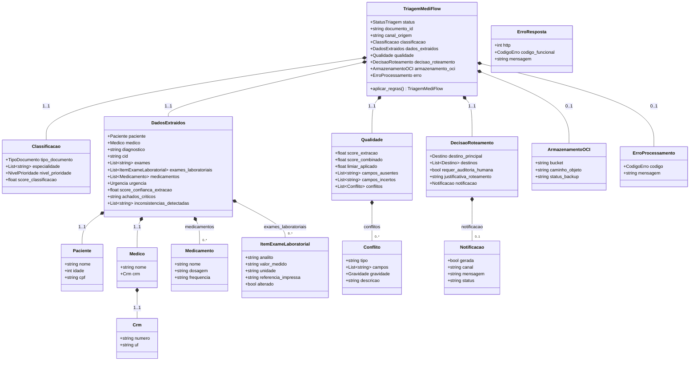
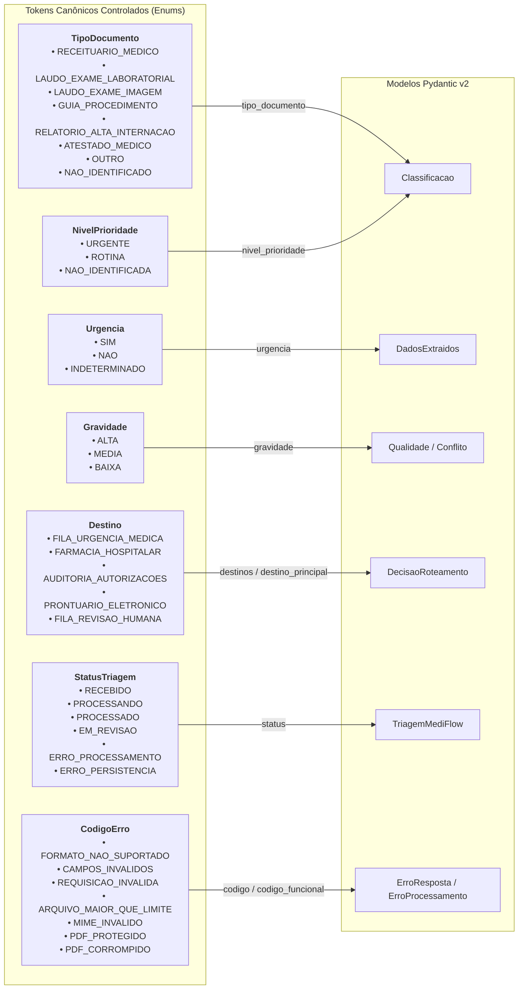
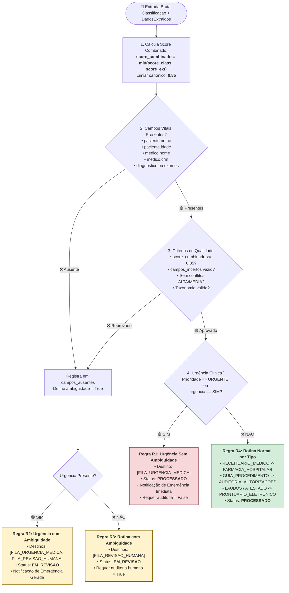

# 📊 Guia Visual dos Schemas e Contratos de Dados — MediFlow

> **Projeto:** MediFlow — Equipe 15 (Hackathon ONE G10 - Oracle & Alura)  
> **Referência Técnica:** [`src/schemas/clinical.py`](../../src/schemas/clinical.py)  
> **Contrato Canônico:** [`docs/testes/CONTRATO_DE_DADOS.md`](CONTRATO_DE_DADOS.md)  
> **Validação:** Pydantic v2 com validação estrita, tolerância resiliente via `_missing_` e motor determinístico de regras (R1 a R8).

---

## 1. 🏗️ Diagrama de Classes e Composição (Pydantic v2)

O diagrama abaixo ilustra o modelo raiz [`TriagemMediFlow`](../../src/schemas/clinical.py) e sua hierarquia de agregação e composição de submodelos clínicos:

---

## 2. 🏷️ Mapa de Enums Controlados e Tokens Canônicos

Todos os enums utilizam **tokens em caixa alta sem acentos nem espaços**, com normalização resiliente automática (`_missing_`):

---

## 3. 🧠 Motor de Decisão Clínica Integrado no Schema (`@model_validator`)

O modelo [`TriagemMediFlow`](../../src/schemas/clinical.py) implementa um validador pós-construção (`@model_validator(mode="after")`) que aplica de maneira determinística as regras **R1 a R8**:

---

## 4. 📋 Dicionário de Componentes e Modelos

| Modelo | Arquivo | Responsabilidade | Sub-entidades Contidas |
| :--- | :--- | :--- | :--- |
| **`TriagemMediFlow`** | [`clinical.py`](../../src/schemas/clinical.py) | **Root Model (Payload Oficial):** Consolida status, classificações, entidades, qualidade, roteamento e metadados OCI. Executa o validador pós-modelo. | `Classificacao`, `DadosExtraidos`, `Qualidade`, `DecisaoRoteamento`, `ArmazenamentoOCI`, `ErroProcessamento` |
| **`Classificacao`** | [`clinical.py`](../../src/schemas/clinical.py) | Categoria estável do documento, especialidade médica, prioridade clínica e score de confiança (0.0 a 1.0). | `TipoDocumento`, `NivelPrioridade` |
| **`DadosExtraidos`** | [`clinical.py`](../../src/schemas/clinical.py) | Entidades clínicas extraídas pelo Gemini Multimodal com validação de formato e filtros anti-alucinação. | `Paciente`, `Medico`, `Medicamento`, `ItemExameLaboratorial`, `Urgencia` |
| **`Paciente`** | [`clinical.py`](../../src/schemas/clinical.py) | Dados demográficos canônicos: nome, idade (`0 <= idade <= 120`) e CPF sanitizado. | — |
| **`Medico`** | [`clinical.py`](../../src/schemas/clinical.py) | Identificação do profissional solicitante com CRM estruturado e normalizado. | `Crm` (`numero`, `uf`) |
| **`ItemExameLaboratorial`** | [`clinical.py`](../../src/schemas/clinical.py) | **RF-12:** Parâmetros bioquímicos estruturados com analito, valor medido, unidade e sinalizador de alteração. | — |
| **`Medicamento`** | [`clinical.py`](../../src/schemas/clinical.py) | Prescrição farmacêutica contendo nome do fármaco, dosagem e posologia/frequência. | — |
| **`Qualidade`** | [`clinical.py`](../../src/schemas/clinical.py) | Governança de acurácia: score combinado (mínimo entre classificação e extração), limiar (0.85), campos ausentes/incertos e conflitos. | `Conflito` |
| **`Conflito`** | [`clinical.py`](../../src/schemas/clinical.py) | Inconsistências clínicas detectadas (ex: `DOSE_SUSPEITA`, `CRM_INCOMPATIVEL`, `DOCUMENTO_MUTILADO`). | `Gravidade` (`ALTA`, `MEDIA`, `BAIXA`) |
| **`DecisaoRoteamento`** | [`clinical.py`](../../src/schemas/clinical.py) | Resultado do motor clínico: destino principal, lista de filas, flag de auditoria humana, justificativa em linguagem natural e alerta. | `Destino`, `Notificacao` |
| **`ArmazenamentoOCI`** | [`clinical.py`](../../src/schemas/clinical.py) | Metadados de persistência em nuvem Oracle (Always Free): bucket, caminho do objeto e status do backup. | — |
| **`ErroProcessamento`** | [`clinical.py`](../../src/schemas/clinical.py) | Erros ocorridos durante a leitura de documentos aceitos no pipeline. | `CodigoErro` |
| **`ErroResposta`** | [`clinical.py`](../../src/schemas/clinical.py) | Rejeição HTTP imediata na camada de ingestão (`400`, `413`, `415`). | `CodigoErro` |

---

## 5. 🛡️ Garantias e Regras de Qualidade dos Schemas

1. **Proteção Extra (`extra="ignore"`):** Todos os modelos aceitam payloads com campos adicionais sem quebrar a desserialização, garantindo interoperabilidade entre agentes e versões da API.
2. **Propriedades de Conveniência:** Suporte transparente a nomes legados (`medico_solicitante`, `diagnostico_principal`, `cid_extraido`, `cid_sugerido`, `score_confianca_classificacao`).
3. **Ponto Fixo e Idempotência:** Uma instância de `TriagemMediFlow` revalidada (`TriagemMediFlow.model_validate(obj.model_dump())`) preserva rigorosamente o mesmo estado, sem oscilação de score ou destinos.
4. **Cobertura de Testes:** 100% dos modelos são validados contra os **79 fixtures canônicos** em [`tests/test_contrato_fixtures.py`](../../tests/test_contrato_fixtures.py) e [`tests/test_schemas.py`](../../tests/test_schemas.py).
