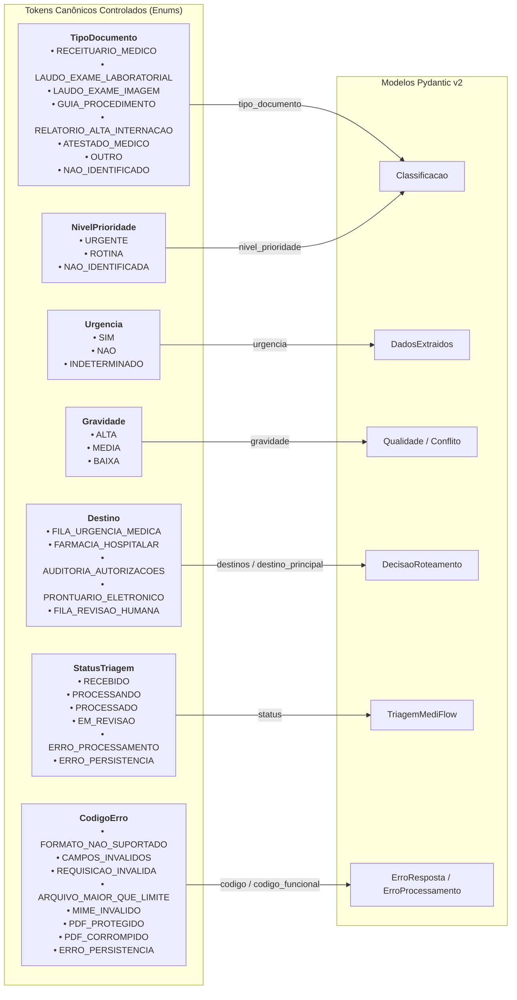
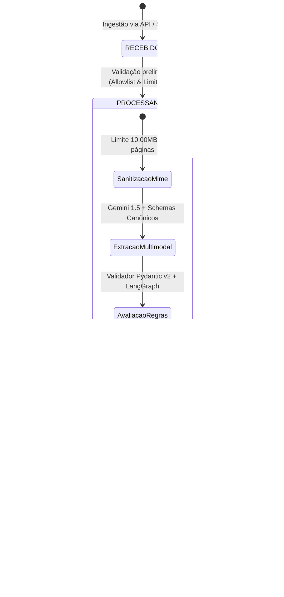
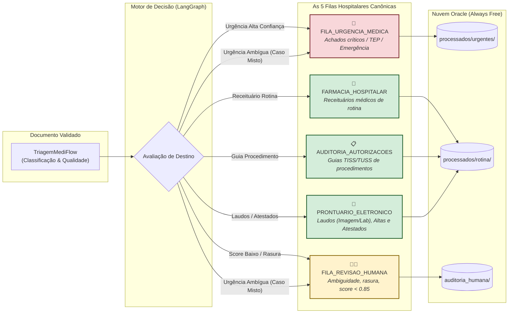
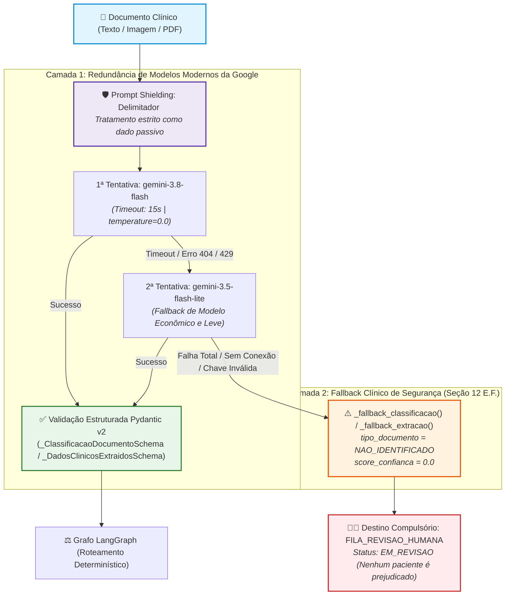

# 📊 Guia Visual dos Schemas e Contratos de Dados — MediFlow

> **Projeto:** MediFlow — Equipe 15 (Hackathon ONE G10 - Oracle & Alura)  
> **Referência Técnica:** [`src/schemas/clinical.py`](../../src/schemas/clinical.py)  
> **Contrato Canônico:** [`docs/testes/CONTRATO_DE_DADOS.md`](CONTRATO_DE_DADOS.md)  
> **Validação:** Pydantic v2 com validação estrita, tolerância resiliente via `_missing_` e motor determinístico de regras (R1 a R8).

---

## 1. 🏗️ Diagrama de Classes e Composição (Pydantic v2)

O diagrama abaixo ilustra o modelo raiz [`TriagemMediFlow`](../../src/schemas/clinical.py) e sua hierarquia de agregação e composição de submodelos clínicos:

---

## 2. 🏷️ Mapa de Enums Controlados e Tokens Canônicos

Todos os enums utilizam **tokens em caixa alta sem acentos nem espaços**, com normalização resiliente automática (`_missing_`):

---

## 3. 🔄 Ciclo de Vida e Máquina de Estados da Triagem

O processamento de qualquer documento pelo ecossistema **MediFlow** é governado por uma máquina de estados finita e auditável:

### Matriz de Transição de Estados

| Estado Origem | Evento / Condição | Estado Destino | Ação / Efeito Colateral |
| :--- | :--- | :--- | :--- |
| `[*]` | Envio via API (`POST /api/v1/triagens`) ou Streamlit | `RECEBIDO` | Emissão de `documento_id`, persistência em `/recebidos` e retorno `HTTP 202 Accepted`. |
| `RECEBIDO` | Início da esteira assíncrona | `PROCESSANDO` | Execução do carregador seguro e sanitização PyMuPDF. |
| `PROCESSANDO` | `score_combinado >= 0.85` e vitais presentes | `PROCESSADO` | Encaminhamento direto para a fila departamental correspondente. |
| `PROCESSANDO` | `score_combinado < 0.85` ou rasura ou vital ausente | `EM_REVISAO` | Retenção obrigatória para auditoria médica (*Human-in-the-Loop*). |
| `PROCESSANDO` | PDF protegido por senha ou corrompido | `ERRO_PROCESSAMENTO` | Geração do envelope `ErroProcessamento` sem invocar IA desnecessariamente. |
| `PROCESSADO` / `EM_REVISAO` | Falha de rede ou timeout com a nuvem Oracle | `ERRO_PERSISTENCIA` | Registro do incidente para retry sem perda de metadados. |

---

## 4. 🧠 Motor de Decisão Clínica Integrado no Schema (`@model_validator`)

O modelo [`TriagemMediFlow`](../../src/schemas/clinical.py) implementa um validador pós-construção (`@model_validator(mode="after")`) que aplica de maneira determinística as regras **R1 a R8**:

---

## 5. 🏥 Roteamento Clínico Hospitalar e Alocação OCI

O diagrama a seguir detalha o mapeamento determinístico entre as entidades classificadas e as 5 filas hospitalares canônicas, bem como a segregação de persistência no OCI Object Storage:

---

## 5.1 🧠 Arquitetura de Duplo Fallback do GeminiService (IA Resiliente)

O diagrama a seguir ilustra a blindagem e o fluxo de extração estruturada do [`GeminiService`](../../src/services/gemini_service.py):

---

## 6. 📋 Dicionário de Componentes e Modelos

| Modelo | Arquivo | Responsabilidade | Sub-entidades Contidas |
| :--- | :--- | :--- | :--- |
| **`TriagemMediFlow`** | [`clinical.py`](../../src/schemas/clinical.py) | **Root Model (Payload Oficial):** Consolida status, classificações, entidades, qualidade, roteamento e metadados OCI. Executa o validador pós-modelo. | `Classificacao`, `DadosExtraidos`, `Qualidade`, `DecisaoRoteamento`, `ArmazenamentoOCI`, `ErroProcessamento` |
| **`Classificacao`** | [`clinical.py`](../../src/schemas/clinical.py) | Categoria estável do documento, especialidade médica, prioridade clínica e score de confiança (0.0 a 1.0). | `TipoDocumento`, `NivelPrioridade` |
| **`DadosExtraidos`** | [`clinical.py`](../../src/schemas/clinical.py) | Entidades clínicas extraídas pelo Gemini Multimodal com validação de formato e filtros anti-alucinação. | `Paciente`, `Medico`, `Medicamento`, `ItemExameLaboratorial`, `Urgencia` |
| **`Paciente`** | [`clinical.py`](../../src/schemas/clinical.py) | Dados demográficos canônicos: nome, idade (`0 <= idade <= 120`) e CPF sanitizado. | — |
| **`Medico`** | [`clinical.py`](../../src/schemas/clinical.py) | Identificação do profissional solicitante com CRM estruturado e normalizado. | `Crm` (`numero`, `uf`) |
| **`ItemExameLaboratorial`** | [`clinical.py`](../../src/schemas/clinical.py) | **RF-12:** Parâmetros bioquímicos estruturados com analito, valor medido, unidade e sinalizador de alteração. | — |
| **`Medicamento`** | [`clinical.py`](../../src/schemas/clinical.py) | Prescrição farmacêutica contendo nome do fármaco, dosagem e posologia/frequência. | — |
| **`Qualidade`** | [`clinical.py`](../../src/schemas/clinical.py) | Governança de acurácia: score combinado (mínimo entre classificação e extração), limiar (0.85), campos ausentes/incertos e conflitos. | `Conflito` |
| **`Conflito`** | [`clinical.py`](../../src/schemas/clinical.py) | Inconsistências clínicas detectadas (ex: `DOSE_SUSPEITA`, `CRM_INCOMPATIVEL`, `DOCUMENTO_MUTILADO`). | `Gravidade` (`ALTA`, `MEDIA`, `BAIXA`) |
| **`DecisaoRoteamento`** | [`clinical.py`](../../src/schemas/clinical.py) | Resultado do motor clínico: destino principal, lista de filas, flag de auditoria humana, justificativa em linguagem natural e alerta. | `Destino`, `Notificacao` |
| **`ArmazenamentoOCI`** | [`clinical.py`](../../src/schemas/clinical.py) | Metadados de persistência em nuvem Oracle (Always Free): bucket, caminho do objeto e status do backup. | — |
| **`GeminiService`** | [`gemini_service.py`](../../src/services/gemini_service.py) | **Serviço de IA Multimodal:** Orquestra classificação documental e extração com transporte REST, timeout de 15s e duplo fallback seguro. | `_ClassificacaoDocumentoSchema`, `_DadosClinicosExtraidosSchema` |
| **`ErroProcessamento`** | [`clinical.py`](../../src/schemas/clinical.py) | Erros ocorridos durante a leitura de documentos aceitos no pipeline. | `CodigoErro` |
| **`ErroResposta`** | [`clinical.py`](../../src/schemas/clinical.py) | Rejeição HTTP imediata na camada de ingestão (`400`, `413`, `415`). | `CodigoErro` |

---

## 7. 🛡️ Garantias e Regras de Qualidade dos Schemas

1. **Proteção Extra (`extra="ignore"`):** Todos os modelos aceitam payloads com campos adicionais sem quebrar a desserialização, garantindo interoperabilidade entre agentes e versões da API.
2. **Propriedades de Conveniência:** Suporte transparente a nomes legados (`medico_solicitante`, `diagnostico_principal`, `cid_extraido`, `cid_sugerido`, `score_confianca_classificacao`).
3. **Ponto Fixo e Idempotência:** Uma instância de `TriagemMediFlow` revalidada (`TriagemMediFlow.model_validate(obj.model_dump())`) preserva rigorosamente o mesmo estado, sem oscilação de score ou destinos.
4. **Cobertura Integral de Testes:** 100% dos modelos são validados contra os **79 fixtures canônicos** e auditados pelos **245 testes automatizados (100% verde)** em [`tests/test_contrato_fixtures.py`](../../tests/test_contrato_fixtures.py), [`tests/test_schemas.py`](../../tests/test_schemas.py), [`tests/test_workflow.py`](../../tests/test_workflow.py), [`tests/test_ingestion.py`](../../tests/test_ingestion.py), [`tests/test_api.py`](../../tests/test_api.py), [`tests/test_gemini_service.py`](../../tests/test_gemini_service.py), [`tests/test_audit_items.py`](../../tests/test_audit_items.py) e [`tests/test_oci_storage.py`](../../tests/test_oci_storage.py).

